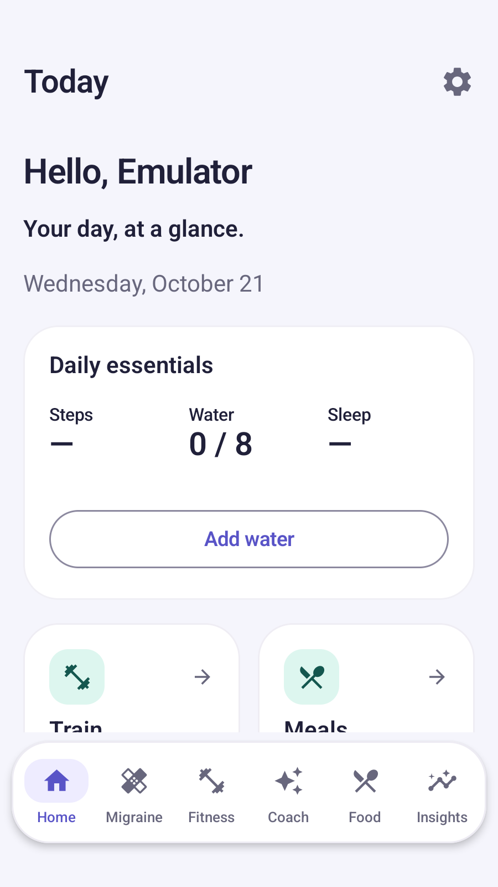
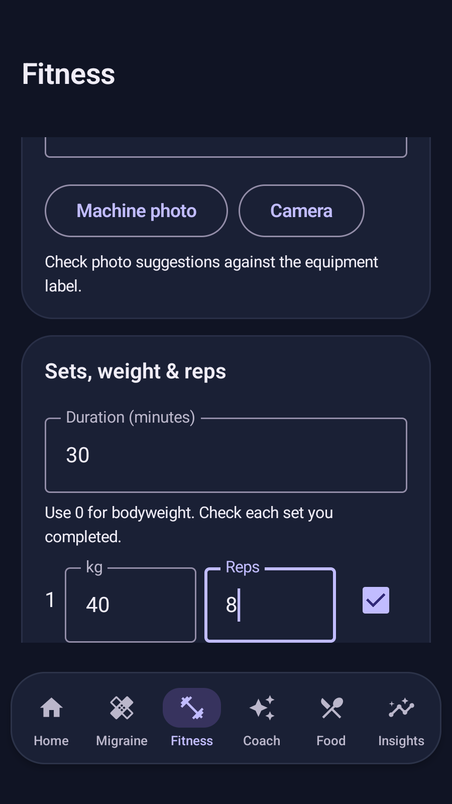
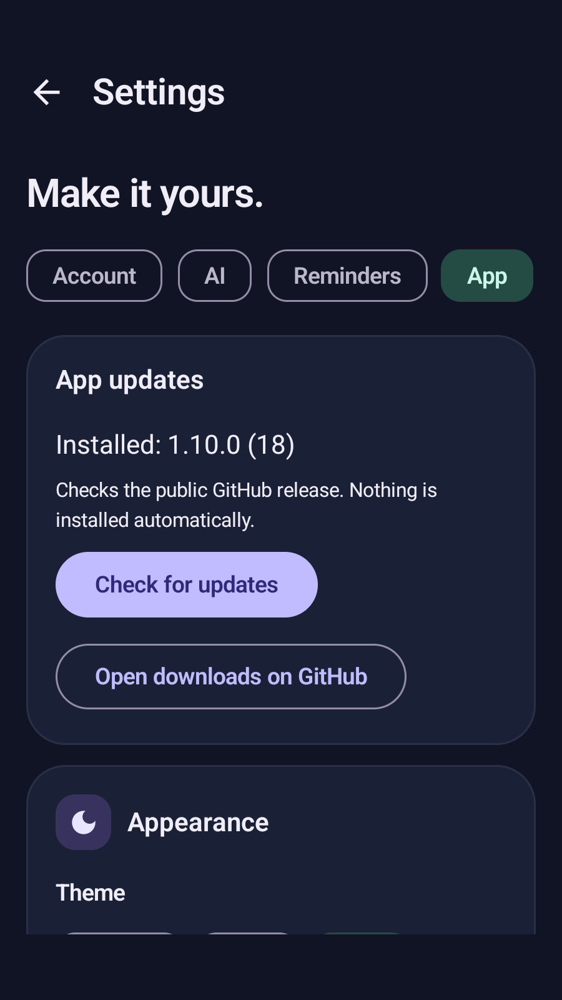

# MigraineGuard

A native Android companion for migraine journaling, movement, sleep, hydration, meals, body measurements, medication check-ins and optional educational AI coaching.

**Latest verified build: v1.10.0 (18)** · Android 8+ · Public signed test APKs

## Download and share

**[Download MigraineGuard](https://github.com/jdp323/migraineguard/releases/latest)** — share this link with friends. Open **Assets** and choose the Standard .apk. No GitHub repository invitation is needed.

- [Standard v1.10.0 APK](https://github.com/jdp323/migraineguard/releases/download/v1.10.0-debug/MigraineGuard-v1.10.0-debug.apk): normal app, com.migraineguard.app. Update in place when the signing certificate matches; keep local records.
- [Preview v1.10.0 APK](https://github.com/jdp323/migraineguard/releases/download/v1.10.0-debug/MigraineGuard-v1.10.0-preview.apk): separate installation beside Standard, with its own storage and permissions.
- [User guide](docs/USER_GUIDE.md): installation, checked setup, daily features, Google Drive restore and data controls.
- [Troubleshooting](docs/TROUBLESHOOTING.md): possible errors, what they mean and how to resolve them.
- [How it works](docs/HOW_IT_WORKS.md): device path, account isolation, AI/backup boundaries and code map.
- [Public website](https://gen-lang-client-0426132502.web.app/) · [Privacy](https://gen-lang-client-0426132502.web.app/privacy.html) · [Terms](https://gen-lang-client-0426132502.web.app/terms.html)

Do not uninstall an old installation containing records to resolve a signature conflict. Use Preview or verify a recovery export first. These are development builds, distributed outside the Play Store; app updates are downloaded from Releases.

## What's new in v1.10.0

Water notifications offer **1 / 2 / 3 glasses** (250 ml each) without opening the app. Training separates Strength, Cardio, Stretching and Other: treadmill speed/incline/distance and stretch hold/rounds use their own fields. A device-encrypted remembered session keeps returning users on Home after a restart; explicit sign-out still clears it. [Usage and changed-file/function reference](docs/UPDATE_1_10_0.md).

A focused Home with daily essentials; a dedicated Migraine overview; Health/Training views with named exercises, optional machine photos, weight/reps/sets, completed-set checks, history and weekly goals. Settings now groups Account, AI, Reminders and App controls.

Choose among eleven AI providers, use optional key-prefix suggestions, test the selected connection and change keys/models after setup. Set separate water/meal/medication/migraine intervals and active hours. Account shows measured Drive snapshot size. App can check GitHub for updates and open the download page; optional background notifications announce a newer release.

<table><tr><td></td><td></td><td></td></tr></table>

[Feature guide, inspected screenshots and changed-file/function reference](docs/UPDATE_1_10_0.md) · [Exact AI prompts and permissions](docs/AI_AND_PERMISSIONS.md). Screenshots use synthetic emulator data.

## Start in a few steps

1. Install the Standard APK, or Preview alongside an existing installation.
2. Choose Google sign-in or Continue locally. Optional Drive app-data authorization checks/restores the selected account before new profile setup.
3. Connect this phone's health data only if it belongs to this app account. Grant the record types you want and check actual received readings.
4. Optionally add your own Gemini key and Save & Test. Skipping verification preserves saved keys; no keys means the offline fallback is available. Remove keys in Settings to stop using those providers.
5. Save your profile, review checks/skips and finish. For Google backup, use Back up now and wait for a completed save before moving devices.

Google audience access is **External / In production**; each Google account authorizes its own private app-data storage. Google login does not include a Gemini key or grant Health Connect permission. Custom Google branding is not claimed to be verified. See [configuration evidence](docs/PUBLIC_GOOGLE_ACCESS.md).

## Devices and health readings

Galaxy Watch data travels through **Samsung Health on the phone → Android Health Connect → MigraineGuard**. Fitbit/other companion apps must export supported records to Health Connect too. There is no direct watch app or live sensor stream.

Fitness shows Samsung and combined Health Connect alternatives, source/timestamp diagnostics and a copyable sync report. Full-day aggregates and conservative labeled raw recovery handle supported Samsung daily buckets. Heart is a dated latest measurement, not live BPM; sleep requires completed sessions. Missing readings remain unavailable. See the [missing-data checklist](docs/TROUBLESHOOTING.md#steps-heart-rate-or-sleep-are-missing-or-different).

## Accounts, backup and privacy

A device-encrypted remembered identity restores the selected profile after restart, without storing Google API tokens. Explicit sign-out clears that session. Each Google account keeps its own local profile, settings, keys and journal. Continue locally preserves its own records. Optional Drive backup restores profile, DOB, measurements, goals, settings, personal provider keys and seven journal tables. Photos and the Health Connect database are excluded.

Drive snapshots use Google's transport/storage protection; portable keys inside the JSON are **not separately password-encrypted or end-to-end encrypted**. Keys are encrypted with Android Keystore locally. Manual password-encrypted journal exports are a separate recovery format and exclude provider keys. Restore merges journals; deletion tombstones and conflict-free simultaneous-device sync are not implemented.

Cloud AI uses your selected provider/key, then offline fallback. Optional legacy Auto uses Gemini → Groq → OpenRouter → offline. Sending the health summary or a meal photo requires the corresponding explicit choice. Opening Insights does not automatically upload health context. Provider quotas/charges vary; historical class names containing Free are not a pricing promise.

[Privacy and deletion details](https://gen-lang-client-0426132502.web.app/privacy.html) · [Public source audit and historical limitations](docs/PUBLICATION_AUDIT.md)

## Verification and remaining phone checks

[Release run 39685744572](https://github.com/jdp323/migraineguard/actions/runs/39685744572) passed **75 JVM tests + 24 Android runtime tests**, compilation, lint (0 errors) and both APK signing checks. Ten inspected API-35 screenshots show Home, Migraine, Fitness, strength/cardio/stretch training and Settings flows. Both public APK downloads were fetched without authentication and their SHA-256 hashes match the built assets.

These tests use synthetic data and simulated Drive transport. Actual watch synchronization, friend-account native Drive transfer, live AI and OEM notification delivery still require phone acceptance. [Phone test checklist](docs/PHONE_TESTING.md) · [Feature status](docs/FEATURE_STATUS.md)

## Build and technical documentation

Use the Gradle wrapper, JDK 17 (CI) or compatible JDK 21, and Android SDK 36. Copy local.properties.example to ignored local.properties and set your SDK location. On Windows use gradlew.bat; on Linux/macOS use ./gradlew.

~~~bash
./gradlew :app:testDebugUnitTest :app:lintDebug :app:assembleDebug
./gradlew :app:assembleDebug -PMG_PREVIEW=true
~~~

Standard output is app/build/outputs/apk/debug/app-debug.apk. Copy it before building Preview because Preview uses the same output path. A local debug signer differs from the published signer, so Google OAuth registration/update compatibility must be configured for that local package/certificate. No Firebase client configuration file is needed by the current Android build.

- [Complete project guide](docs/PROJECT_GUIDE.md): architecture, repositories, database, network boundaries and release operations.
- [File/function reference](docs/FILE_REFERENCE.md): detailed baseline reference; later supplements document changed/new functions.
- [v1.6.4](docs/UPDATE_1_6_4.md), [v1.6.6](docs/UPDATE_1_6_6.md), [v1.7.0](docs/UPDATE_1_7_0.md), [v1.8.0](docs/UPDATE_1_8_0.md), [v1.9.0–1.9.1](docs/UPDATE_1_9_0.md): implementation and verification supplements.
- [Development takeover](docs/TAKEOVER.md) and [initial audit](docs/PROJECT_AUDIT.md): historical context, local recovery and signing continuity.
- [Website files/deployment](website/README.md).

Report reproducible problems through [GitHub issues](https://github.com/jdp323/migraineguard/issues), using the redacted template in Troubleshooting. Issues are public: never attach keys, tokens, medical records or backup files.

MigraineGuard is a wellness and educational tracking tool, not a medical device or substitute for professional care. AI personas are not clinicians. Independent project; not affiliated with Google, Samsung or Fitbit.

**Multiple-device backup compatibility:** update all devices before editing/restoring this backup. Older app versions can ignore and later overwrite newer training/provider/reminder fields. Avoid simultaneous edits; Drive snapshots are not conflict-free live sync.
