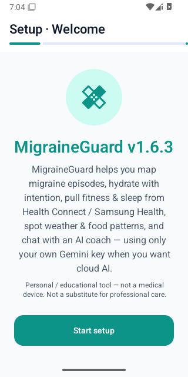
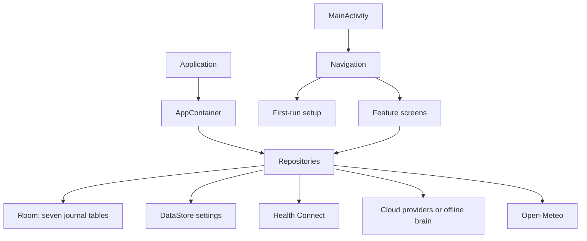
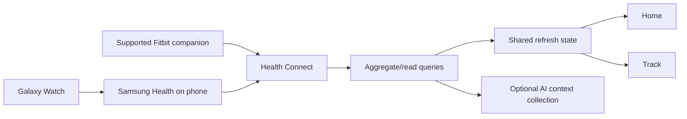

> Current v1.8.0: [interface, navigation, verified setup and changed-file/function reference](UPDATE_1_8_0.md).

> Current v1.7.0: [Drive account restore, Samsung query fixes, UI and complete changed-file/function supplement](UPDATE_1_7_0.md). This supersedes the older cloud-backup placeholder and current-version descriptions below; historical source references remain pinned to their stated baselines.

> Current account ownership, Health Connect query behavior, new files/functions and test coverage are documented in [v1.6.6](UPDATE_1_6_6.md). Original local data is retained under Continue locally.

# MigraineGuard — complete project guide

Current update: [v1.6.4 changes, new files/functions and access checks](UPDATE_1_6_4.md). The detailed source-line reference below preserves the v1.6.3 baseline.

Documentation baseline: **v1.6.3**, application source commit `61cc34b3a7c9614fe6ee20944a0ab0de058b0dfa`, reviewed 2026-10-08. Documentation commits may be newer than this application baseline.

Read this guide for architecture and end-to-end behavior. Read [FILE_REFERENCE.md](FILE_REFERENCE.md) for every tracked file, declarations, functions, inputs and important implementation details. [FEATURE_STATUS.md](FEATURE_STATUS.md) distinguishes implemented features from remaining integrations. [PHONE_TESTING.md](PHONE_TESTING.md) covers installation and signing. [PROJECT_AUDIT.md](PROJECT_AUDIT.md) preserves the initial source audit; its earlier findings are a historical baseline.

## 1. What the product does

MigraineGuard is a native Android application combining a migraine journal, pain map, hydration log, phone/watch health readings, manual workouts, meal analysis, body measurements, medication check-ins and educational AI coaching. Its primary persistence is local. Google sign-in is optional for these local workflows. Cloud AI requires the user's own provider key. It is an educational tracking tool, not a clinically validated diagnostic system.

The phone reads shared health data through **Health Connect**. Samsung Health is the intermediary for a Galaxy Watch. A Fitbit companion app must likewise export supported records to Health Connect before this application can read them. This project does not contain a Wear OS app, a direct watch sensor service, a Samsung privileged SDK integration or a Fitbit OAuth server.

The app has two install identities:

| APK | Package | Intended use |
|---|---|---|
| Standard | `com.migraineguard.app` | Normal updates of installations with the retained signing key |
| Preview | `com.migraineguard.app.preview` | Test beside an older installation and preserve its data |

Preview has separate application storage, permissions, onboarding and API-key settings. It cannot read the older app's private database. Backups exported by this version can be imported into another installation with the password. Older versions without an export feature cannot be silently migrated across package identities or incompatible signing keys.

## 2. Verified release and practical limits

[Release v1.6.3](https://github.com/jdp323/migraineguard/releases/tag/v1.6.3-debug) contains the two APKs, signing certificate and SHA256SUMS. [CI run 37739877149](https://github.com/jdp323/migraineguard/actions/runs/37739877149) passed compilation, Android lint, **29 unit tests**, and **four Android emulator tests** on API 35. The emulator tests verify preservation migrations from database versions 1–3, encrypted backup/restore across all seven tables, API-key encryption on disk, and activity startup. Startup was also captured as an image:



| Artifact | SHA-256 |
|---|---|
| Standard APK | `d4b361f178d470ae79f4e4faf8a839a0bfd9ccdc571673cec9f2dc0db661c26d` |
| Preview APK | `7916affd21cb34771b5d9e548bce922c2a6ce6499dc2b6a0a065010773916143` |

The saved GitHub secret was consumed successfully and both APKs use the retained certificate:

`FB:67:0D:1D:96:C2:8B:9E:27:0D:36:F8:D6:57:53:E3:6B:30:8D:E8`

Passing these tests does not establish that every visual interaction, background state, OEM Health Connect behavior or cloud provider response has been tested. Actual Samsung/watch totals, real Gemini photo responses, notification delivery under Samsung battery management and Google authentication still need phone verification. No live health records or real AI credentials are included in test fixtures.

The signed-in account currently cannot administer the configured Google Cloud project `migraineguard-66229`. Its console reports missing project/OAuth permissions. Registering the correct Android package and certificate requires that project's owner, or a new project owned by the user with matching Web and Android OAuth clients. This is an external setup dependency. Continue locally remains usable.

## 3. Technology and project layout

| Layer | Implementation |
|---|---|
| UI | Kotlin, Jetpack Compose, Material 3 |
| Navigation | Navigation Compose plus conditional setup/auth/profile screens |
| Local journal | Room / SQLite, schema version 4 |
| Settings | Preferences DataStore |
| Async work | Kotlin coroutines and Flow; WorkManager for reminders |
| Health | AndroidX Health Connect client |
| Google auth | Android Credential Manager and Google ID credential |
| Cloud requests | OkHttp with cancellable request bridge |
| Serialization | kotlinx.serialization for persisted structured records/backup; org.json for cloud payloads |
| Security | Android Keystore AES-GCM for API keys; password-derived AES-GCM for portable backups |
| Build | Gradle wrapper 8.11.1, Android Gradle Plugin, Kotlin, KSP |
| CI | GitHub Actions build, hosted Android emulator and release jobs |

The Android module is `app/`. Source starts at `app/src/main/java/com/migraineguard/app/`. `core/` contains shared models, storage, AI, design and security. `feature/` groups user-facing workflows. `di/AppContainer.kt` constructs shared objects manually; there is no Hilt graph. `navigation/` connects screens and passes dependencies. Resources and the manifest live under `app/src/main/`. JVM tests are under `app/src/test/`; real Android tests are under `app/src/androidTest/`.

## 4. Startup, ownership and navigation

`MigraineGuardApp.onCreate()` creates one `AppContainer` for the application lifetime. The container obtains the singleton Room database, preferences, repositories and an application coroutine scope using SupervisorJob. It builds the provider chain and exposes the objects needed by the UI.

`MainActivity.onCreate()` installs Compose content. Preference changes choose theme/dynamic color. `MainActivity.onResume()` requests a health refresh. UI screens collect Flow with lifecycle awareness and launch user actions through coroutine scopes.

`MigraineGuardNavHost` first evaluates persisted setup flags. Until `setupComplete` is true it renders the ordered setup wizard. Once complete it can render a requested Gemini reconnect or profile editor. A signed-out session sees SignInScreen; the local continuation option establishes a usable local session. The main NavHost starts at Home and offers Home, Migraine, Track, Coach, Food and Insights tabs. Water, Body and Medications are separate routes reached from shortcuts. Settings contains configuration and backups.

Bottom-tab navigation saves/restores route state and uses single-top navigation to avoid duplicate tabs. It also requests a debounced health refresh. Local screen state usually uses Compose remember/rememberSaveable; durable journal data must be written to a repository. An unsaved form is not equivalent to a persisted record.



## 5. Storage, models and units

Domain models in Models.kt keep Android/Compose out of the shared data types. Entity objects in Entities.kt define database columns and map to/from domain values. Converters.kt serializes symptom/trigger lists and pain markers to JSON text columns. It recognizes known enum values rather than inventing values from unknown names.

| Room table | Stored information | Principal repository |
|---|---|---|
| `migraine_episodes` | Time, intensity, notes, symptoms, triggers, normalized pain-map points | MigraineRepository |
| `nutrition_scans` | Food label, nullable nutrition estimates, notes, image reference, optional trigger hint | AiNutritionAnalyzer |
| `water_history` | ISO local date and cup count | WaterIntakeRepository |
| `workouts` | Time, activity type, duration, optional calories, notes, suggestion flag | WorkoutRepository |
| `weight_entries` | Time, kilograms, notes | WeightRepository |
| `medications` | Name, dose label, time label, taken date/flag and last-taken timestamp | MedicationRepository |
| `ai_sessions` | Persona, title, user prompt, full answer, summary and time | AiCoachRepository |

A health snapshot is obtained from Health Connect rather than stored as a full historical time series in these tables. Weather caching is in memory. The current Insights screen combines historical journal aggregates with clearly labeled current health/weather snapshots; it does not calculate a historical step total, sleep average or personal weather correlation.

Timestamps use epoch milliseconds; local-day groupings use the device timezone. Weight is stored in kilograms, height in centimeters and distances from Health Connect in meters. Display conversions happen at the UI boundary. Hydration is stored as integer cups; its display unit does not turn the record into a precise measured fluid-volume sensor reading.

DataStore stores goals, theme, body profile, energy check-in/date, onboarding flags and provider keys. The API-key fields on disk contain ciphertext. The preference Flow decrypts them in memory for request/settings use. Access to private storage still matters: API-key encryption is not a claim that the entire journal database is encrypted.

Room schema upgrades use PreservingMigrations.ALL. Versions 1, 2 and 3 migrate directly to 4: missing tables are created and the triggers column is added when absent. Destructive fallback was removed. A future schema change must add a new migration and preservation tests rather than deleting old data to make a build work.

## 6. Migraine journal and pain map

MigraineScreen offers logging, history and detail panes. A user selects symptoms/triggers, overall intensity, notes and one of the front/left/back/top head views. Tap coordinates on the displayed image are normalized to 0–1 and stored with the view identifier and point intensity. Drawing helpers convert normalized points back into display coordinates, choose intensity colors and paint markers.

Saving constructs a MigraineEpisode and sends it through MigraineRepository to MigraineDao. The Room Flow updates history automatically. Selecting an existing episode reads its details; deletion removes the selected row. Range queries feed Insights and the AI context pack. Point frequency or tagged trigger frequency is descriptive; this code does not establish causation or make a medical diagnosis.

## 7. Health Connect, daily totals and refresh

The app first checks SDK/provider availability and granted permissions. It requests read access for steps, heart rate, sleep, exercise, distance and total calories; the existing permission contract also declares exercise write access, but manual workouts are currently stored locally, not automatically exported.

Fitness queries have two different time windows:

1. **Cumulative daily counts** — local midnight to the next local midnight for steps, distance and calories.
2. **Measurements/session duration to date** — local midnight to the current instant for heart-rate records and exercise duration.

Health Connect rescales interval counts when a query clips a record. Therefore a daily cumulative record whose end is tonight can be undercounted by a midnight-to-now query. The reported 12–14 versus 180 steps early in the morning was consistent with that behavior, although the actual Samsung record was not inspected. The full-day query fixes this class of undercount without multiplying a displayed value or summing raw records. The local-day helpers use calendar boundaries, so daylight-saving days can be 23 or 25 hours.

Steps use the Health Connect aggregate API, preserving its duplicate handling and activity-source priority. A separate Samsung-filtered aggregate is displayed as a **comparison**, never added to the combined total. StepSyncSnapshot records nullable total/Samsung total, contributing packages, read time and explanation. Missing access/no data is distinguishable from a measured zero through the nullable diagnostic total.

Distance uses its aggregate. Heart rate reads the latest available record and its latest sample, not an average pulse. Exercise minutes use aggregated exercise-session duration, not a made-up conversion from steps. Calories from multiple writers are handled cautiously: if Samsung is one contributor, a Samsung-only aggregate is selected and labeled; if multiple sources exist without Samsung the total is withheld rather than blindly summing possible duplicates.

Sleep reads recent sessions and reports recorded session duration/source. The label is not a sleep-stage score or a medical quality assessment. HealthAutoRefresh loops every 30 seconds only while a screen is resumed. HealthRefreshCoordinator shares one StateFlow and debounces tab/resume reads. Ordinary refreshes do not cancel an already-running request; forced actions can replace work.

Data path:



If Samsung Health shows more steps, inspect **Health Connect's actual Steps entries**, writer permission and source priority. A watch-only number that has not reached Health Connect cannot be recovered by refreshing this app. The app does not log or upload raw device health records to GitHub.

## 8. Hydration, workouts, body and medications

WaterIntakeRepository migrates the earlier DataStore cup/date pair into Room once. A mutex prevents competing migrations, and the greater existing count is preserved. Today’s Flow follows the local date, polling the boundary every 30 seconds; all increment/decrement operations use Room transactions. Removing a cup clamps at zero. History and averages read the same table, avoiding competing counters.

WorkoutRepository stores manually entered WorkoutEntry objects. The Exercise of the Day comes from a fixed catalog indexed by day of year; it is not an AI-generated personalized workout plan. Users can log the suggested exercise as a local workout. Health Connect exercise minutes and manually logged workouts remain separate representations and should not be added as though they cannot overlap.

WeightRepository stores kilogram readings. BodyMetricsScreen displays the list/trend and optional goal. ProfileSetupScreen uses BodyUnits helpers to convert between kilograms/pounds and centimeters/feet/inches. Switching display units retains the physical measurement instead of treating the old number as a different unit. Date of birth uses a date picker, with future dates rejected.

MedicationRepository stores user-entered labels and a daily taken state. Marking taken updates the date and timestamp. The repository interprets an older taken date as not taken today when records are emitted again. Medication reminders are generic check-ins every six hours through WorkManager; the entered timeLabel is not an exact dose alarm. The project does not recommend prescriptions, calculate doses or check drug interactions.

## 9. Nutrition and photographs

Description analysis uses FallbackAiClient.analyzeNutrition. It asks for structured nutrition JSON and parses only usable values. Failed or malformed analysis returns unknown calories/macros, not fabricated numbers. Valid zero is kept; negative/non-finite values are discarded. Legacy entries with the old “Structured estimate” placeholder prefix have their fabricated numbers/trigger hints suppressed when mapped into domain records.

A photo may be retained as a local reference. It is not sent merely because it was selected. NutritionScreen provides an explicit **send photo to Gemini** choice and explanatory cost/data text. Gallery selection uses OpenDocument and attempts to retain URI read permission. Camera pictures use a FileProvider URI in the app's files/food_photos directory.

For a selected send:
1. prepareFoodImage reads a bounded source, decodes/downsamples it, limits the longest side to 1600 pixels and re-encodes JPEG.
2. Re-encoding drops original metadata, including embedded location metadata; source/output sizes are bounded.
3. GeminiFreeProvider sends text plus inline base64 JPEG in the Gemini request, using the user's key in a request header.
4. Parsed estimates and caveats are saved locally. Errors keep nutrition unknown.
5. A photo request does not silently fall through to another cloud provider.

The text-only fallback test about attached photos applies to the description-only path: it must never claim to have seen a photo. It does not prevent the explicit Gemini image path implemented separately. Food recognition is approximate and portions/allergens require user checking; no food-label database or barcode integration is implemented.

## 10. AI providers, personas and privacy choices

AiProvider is a small interface with name, priority and suspend complete(prompt). AppContainer configures Gemini, Groq, OpenRouter and OfflineHealthBrain. The file name StubProviders.kt is historical: it now contains real HTTP providers. Provider defaults in BuildConfig are empty.

FallbackAiClient tries providers by priority. Exceptions, empty answers and a provider-specific timeout permit fallback. Cancellation from navigation/the parent coroutine is rethrown and never triggers an additional provider transmission. The first successful answer ends the chain. The UI's gradual answer display is chunking a completed response; it is not server token streaming.

Coach and Health Analyst are educational personas defined in Personas.kt. AiCoachRepository assembles a context pack from preferences, journal windows, hydration, current Health Connect values, recent workouts, meals, medications and energy. The offline brain can use this local context. A cloud health-summary checkbox defaults off; only when selected is context JSON attached to cloud prompts. The user's typed message itself is sent to the chosen cloud provider when cloud AI is used. Fallback can try another configured cloud provider after failure.

Automatic Insights narrative stays local/offline. No personal health summary is sent merely by opening Insights. Offline reports use templates/descriptive statistics; they are not equivalent to a language model performing a validated clinical assessment. Missing step readings are left unavailable rather than interpreted as inactivity.

Successful replies are stored in ai_sessions with the user prompt and full response. Sign-out does not purge the journal. The app does not have a backend account database, payment service or team-sharing server. The v1.6.3 baseline had no automatic Drive backup; [v1.7.0](UPDATE_1_7_0.md) adds account-scoped app-data backup/restore with native Google authorization.

## 11. Weather

OpenMeteoWeatherRepository needs optional coarse location permission. Home explicitly asks to enable weather and explains that approximate coordinates are sent to Open-Meteo. Coordinates are rounded to two decimal places; precise coordinates are not displayed. It uses a recent last-known fix or a cancellable current-location request with a timeout.

A successful response is cached for 30 minutes. Failed refresh may return the previously obtained actual sample marked stale. With no sample, currentWeather returns null. The UI shows unavailable/stale states; it does not substitute a plausible pressure/temperature. Stale samples are excluded from current weather risk hints and AI context. Weather codes map to simple labels. No pressure history or personal pressure/migraine correlation is collected.

## 12. Security, portable backup and deletion behavior

ApiKeyVault generates/loads a device-bound AES-256 key in Android Keystore. Each key save uses a fresh GCM IV, stores the version prefix plus encoded IV/ciphertext and decrypts only for use. Preferences migrates earlier plaintext keys atomically before emitting the newer settings. If decryption fails, the key is treated as unavailable and can be re-entered; ciphertext must never be sent as an API key.

BackupCipher uses PBKDF2-HMAC-SHA256 with 600,000 iterations, a random 16-byte salt, random 12-byte nonce and AES-256-GCM. The version header is authenticated. Portable backups require a password of at least eight characters and enforce a 20 MB plaintext bound. Losing the password loses access to that backup; no recovery password is embedded.

BackupRepository exports a consistent transaction snapshot of all seven tables plus optional body profile/goals. It excludes provider keys and removes image URI references; photo files are not packaged. Android's system file picker chooses the output/input location. A user may choose a Drive folder in that picker, but this is a manually selected encrypted file, not background sync.

Restore reads a bounded file, decrypts/authenticates and validates before writing. Inserts run in one Room transaction. Primary keys are normalized so colliding source IDs do not overwrite different target records. Identical content is deduplicated, making re-import idempotent. Water restores the maximum of existing and incoming count for a date. Profile/goals are restored only if selected; their DataStore updates occur after the database transaction, so a settings failure can leave journal restore successful but profile unchanged.

Individual delete actions remove the selected row. Cloud providers may have their own retention; deleting local AI/food history does not retract an already-sent request. Automatic Android cloud backup and device-transfer inclusion are disabled/excluded. Do not uninstall an old signing-incompatible app containing important records.

The GitHub repository remains private. The original configuration/history contains Firebase client configuration and commit metadata that has not been sanitized for public release. Firebase client config is not a user Gemini credential, but the user's stricter no-personal-info/no-key publication condition has not been met. Signing keys, local properties, backups, verification downloads, APKs and runtime data are ignored. Do not commit files from .local-android or private device exports.

## 13. Build, test and release operations

Use JDK 17 (CI baseline) or a compatible JDK 21 with the wrapper. The Android Studio bundled JDK 25 on this VM was incompatible with this Gradle version. Set Android SDK path in local.properties using local.properties.example; local.properties stays ignored.

Windows:
```powershell
$env:JAVA_HOME = 'C:\path\to\jdk-17'
.\gradlew.bat :app:testDebugUnitTest :app:lintDebug :app:assembleDebug
.\gradlew.bat :app:assembleDebug -PMG_PREVIEW=true
```

Linux/macOS:
```bash
./gradlew :app:testDebugUnitTest :app:lintDebug :app:assembleDebug
./gradlew :app:assembleDebug -PMG_PREVIEW=true
```

The preview property changes applicationId/label without creating a separate source implementation. Its output file still uses the debug output path; copy the standard APK before building Preview or that path is replaced. CI follows this order.

The workflow's build job restores MG_DEBUG_KEYSTORE_BASE64 only for eligible non-PR builds, checks its SHA-1, sets the explicit MG_DEBUG_KEYSTORE_PATH, builds unit/lint/main/instrumentation artifacts, then builds Preview and verifies both certificates. Pull-request jobs do not consume signing secrets or publish. Missing secret allows checks but suppresses release publication.

The Android runtime job downloads the primary/test APKs onto a GitHub-hosted Linux machine, enables KVM on that ephemeral host, boots an API-35 emulator, installs and runs the four instrumentation tests and captures startup. It avoids running a large emulator on this 4 GB VM. Tests use synthetic data and clean their fixtures.

Publishing requires build and runtime success, a push event and stable-signing=true. It creates vVERSION-debug from the source commit, attaches both APKs/certificate/digests, and marks the release latest. Existing tags/releases are not overwritten. A new source binary release needs a higher versionCode/versionName. Download APK assets from Releases rather than assuming the main branch's older source version equals the latest APK.

The working development branch is codex/github-build-and-takeover and [draft PR #1](https://github.com/jdp323/migraineguard/pull/1) collects it. Native Git authentication/network access was unavailable on this VM. The connected GitHub tool supports guarded tree/commit/ref updates; local Git objects were imported with exact SHA-1 verification so local history matches remote. No personal access token was placed in source files. tools/git-manage.cmd supports local status, snapshots and bundles; network push still requires valid native Git authentication if performed outside the connector.

## 14. Test suite map

| Suite | Count | What it protects |
|---|---:|---|
| FallbackAiClientTest | 6 | Priority, blank/error fallback, timeout and cancellation boundaries |
| NutritionIntegrityTest | 6 | Unknown nutrition, parsing bounds, zeros, no false photo claim, old placeholder suppression |
| BackupCipherTest | 3 | Randomized round trip, wrong passwords/tampering, invalid/short inputs |
| HealthDayTest | 5 | Local midnight, full current day, 23/25-hour DST days |
| BackupMergeTest | 2 | Source ID collisions and repeated-content imports |
| StepSyncMessageTest | 5 | Missing/failed Samsung reads and priority/arrival explanations |
| BodyUnitsTest | 2 | Saved height and physical-weight retention during unit conversion |
| AppReliabilityTest, Android | 4 | Versions 1–3 migrate preserving records; all-table backup roundtrip; encrypted keys; activity launch |

These tests do not use the user's accounts or modify a real phone's Health Connect database. There is no full automated screenshot/navigation test for every screen yet. APK privacy string scans were limited checks, not a complete security assessment or proof of all history being safe to publish.

## 15. Troubleshooting and maintenance priorities

| Symptom | Check and remedy |
|---|---|
| APK won't install over an older one | Check package/certificate. Prefer Preview and retain old records; do not force an uninstall. |
| Google SHA-1 error | Register actual installed package/certificate in the same Cloud project as the Web client. Settings shows the runtime certificate. |
| Google console asks for access | Use a project-owner account or owned OAuth project; unrelated roles do not repair an incorrect project/client pairing. |
| Samsung total exceeds app | Compare combined/Samsung diagnostics and actual Health Connect records; check Samsung writer permission, watch-to-phone sync, activity priority and full-day query version. |
| Steps missing after permissions | Return to foreground and refresh; partial grants are handled per metric. Absence is not proof of zero activity. |
| Gemini key fails | Save & Test checks only a small text call. Verify the key's own provider/project/quota; photo analysis is a separate request. |
| Meal numbers absent | Provider output was unavailable/unusable; add description/portion information and retry rather than treating unknown as zero. |
| Weather missing | Grant optional coarse location, turn location services on and retry; stale data is labeled. |
| Reminders absent | App toggle, notification permission/channel and OS scheduling/battery policy all matter. These are periodic check-ins, not exact alarms. |
| Backup won't restore | Correct password, recognized format and size/record validation are required. Failure before transaction leaves journal unchanged. |
| Old medication check remains visible at midnight | Fixed after the baseline by the local-date Flow documented in v1.6.4; verify the installed build version if it persists. |
| Historical Insights appears to show today's steps | The report deliberately labels current snapshots; historical Health Connect series are a future enhancement. |

Near-term improvements should prioritize a phone-tested Health Connect matrix, an owned Google OAuth setup, stronger UI/navigation regression coverage, exact optional medication schedules with appropriate Android alarm handling, historical health/weather series with explicit sampling/source semantics, and an intentionally designed multi-device sync backend if required. Do not describe these as already implemented.

## 16. How to safely extend the code

For a new feature: add or extend a domain model, storage boundary, repository and screen, wire the repository in AppContainer and route in MigraineGuardNavHost, then document the file and user workflow. Keep Android dependencies out of pure domain/calculation helpers where possible.

For a new table/column: increment Room version, export the schema, write a preservation migration from supported versions, test an old populated database, and include new records in encrypted backup when appropriate. Never reintroduce fallbackToDestructiveMigration as a shortcut.

For AI changes: document the data sent, keep opt-in health/photo gates, preserve coroutine cancellation, bound response/image sizes and preserve unknown values. A provider/model being labeled “free” in old class names does not guarantee current billing or quotas.

For Health Connect changes: choose calendar versus instant windows explicitly, use aggregate for cumulative deduplicated activity, distinguish absence from zero, preserve data-source labels and do not silently mix manual logs with imported records.

For documentation updates: update this guide's baseline/evidence and FILE_REFERENCE entries whenever files/functions change. Source links and line numbers describe the stated baseline. Anonymous lambdas are explained within their owning screen rather than listed as named functions; generated Room/Compose/build outputs are not hand-maintained project source.
