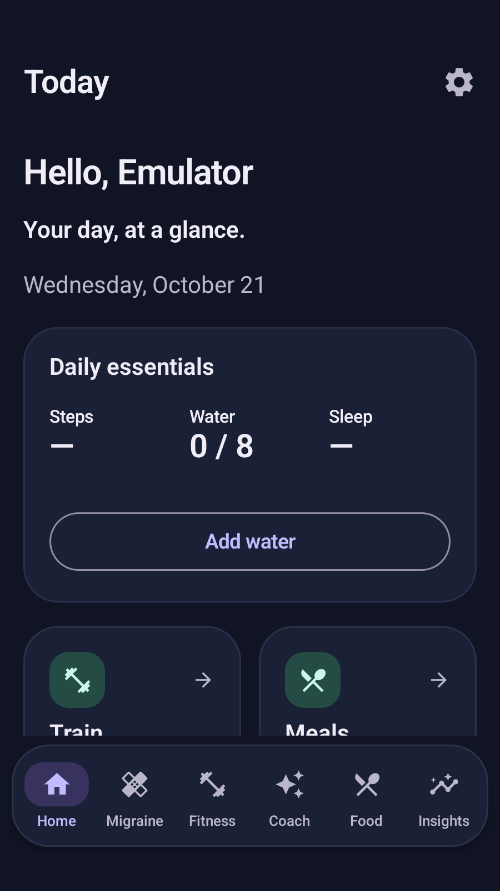
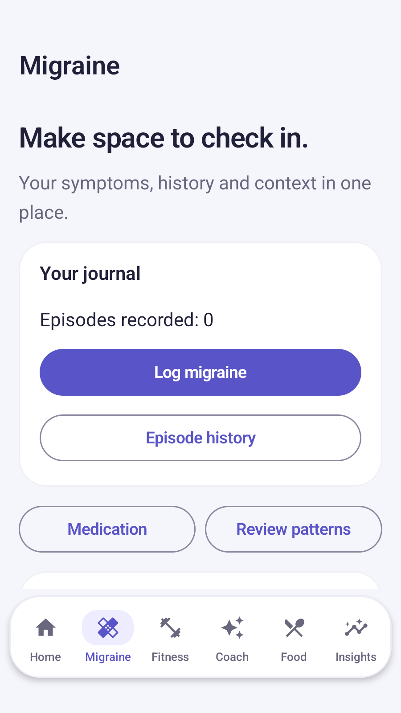
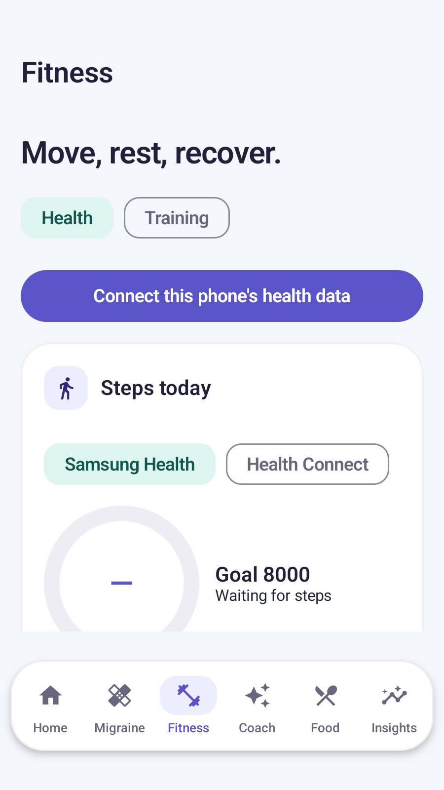
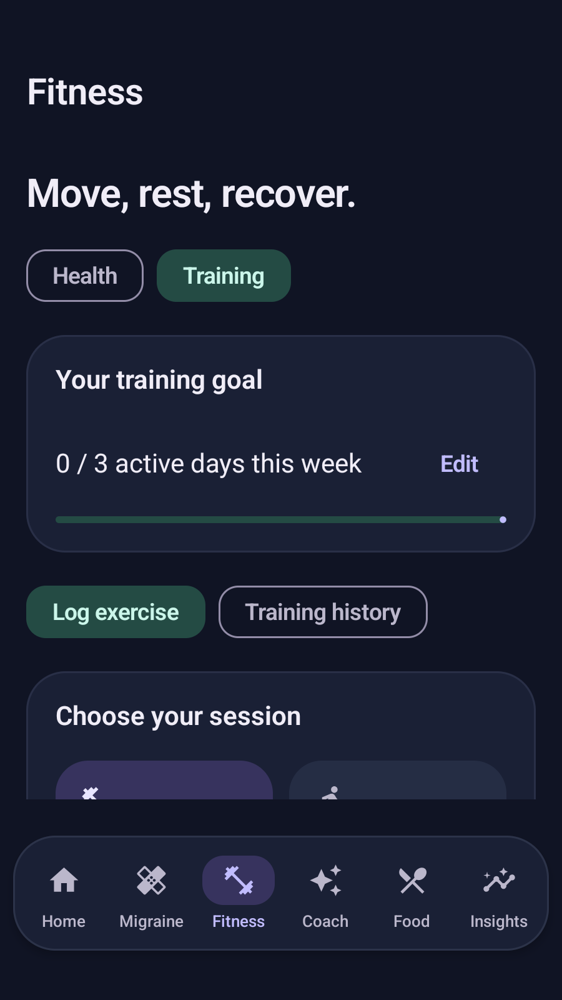
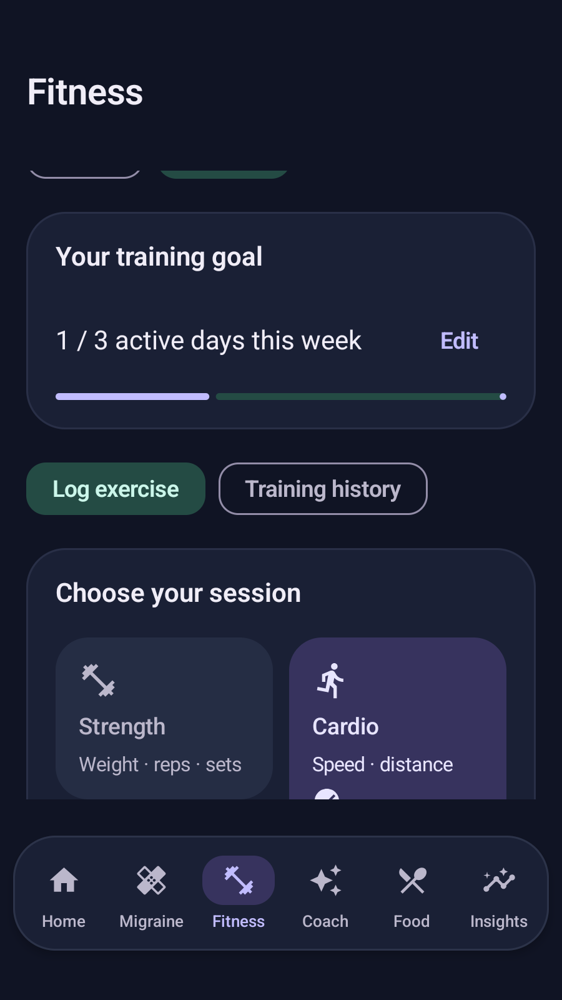
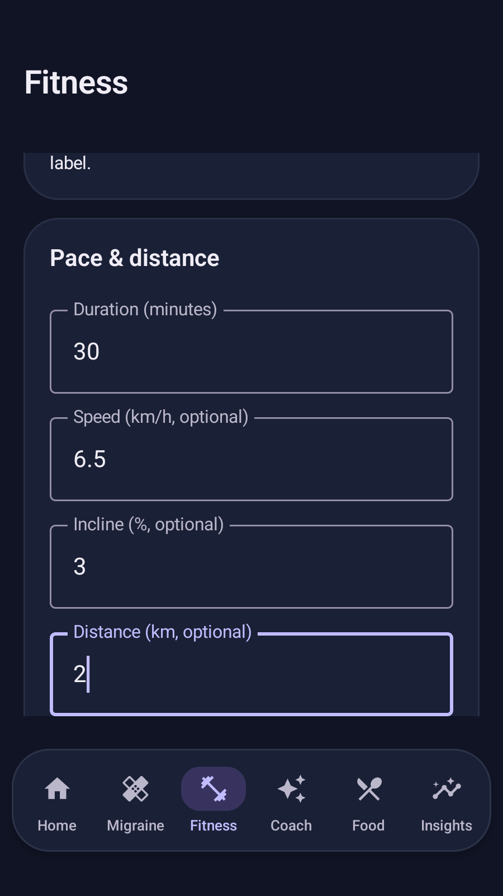
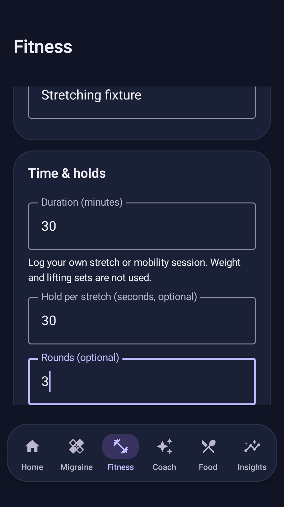

# v1.10.0 — water quick actions, activity-specific logs and remembered sign-in

Application 1.10.0 / code 18. Extends [v1.9 features](UPDATE_1_9_0.md), [user guide](USER_GUIDE.md) and [AI prompts/permissions](AI_AND_PERMISSIONS.md). [Published APK release](https://github.com/jdp323/migraineguard/releases/tag/v1.10.0-debug).

## Water from a notification

Enable notifications and Drinking water under Settings → Reminders, grant Android notification permission and choose the interval/active hours. Expand the **Time for water** notification to see **1 glass**, **2 glasses**, **3 glasses**. Each glass is the existing 250 ml journal unit. A choice adds 250/500/750 ml to the current local calendar day, closes that reminder and updates the normal water history. You can correct the total in Water. Tapping the notification body opens Water as before.

A notification is one opportunity to log a drink, not three separate drinks: a durable transactional receipt rejects repeated/different-button taps for the same notification. The latest reminder supersedes older buttons; actions expire after 24 hours, stop when water/master reminders are off, and reject a different or signed-out account. Explicit sign-out/account switching invalidates the action. Receipts are local-only, pruned after two days and excluded from Drive/manual journal exports. They are not health sensor records. Actions request an unlocked device on supported Android versions; Android decides which buttons are displayed. Background work can be delayed by OS limits. A cold app start preserves an otherwise valid action for the remembered account.

Quick logging does not launch the camera, query Health Connect, call AI or grant permissions. Optional Drive synchronization resumes when the account reconnects; if you log while the app is closed/offline, open it and confirm Back up now before switching devices.

## Choose the right exercise fields

Fitness → Training → Log exercise now has four selectable session tiles, including a separate Stretching tile:

| Tile/type | Fields |
| --- | --- |
| Strength | Exercise/machine name, duration, weight in kg/lb, reps, completion checkbox per set; optional calories/notes/photo |
| Cardio → Treadmill | Name, duration, optional speed (km/h or mph), incline (%) and distance (km or mi); optional calories/notes/photo |
| Cardio → Walk, Run, Cycling, Rowing, Elliptical | Name, duration, optional speed/distance; optional calories/notes/photo |
| Stretching → Stretching or Yoga | Movement name, duration, optional hold seconds per stretch and rounds, calories/notes; no weight/reps or machine-photo panel |
| Other | Name, duration and optional calories/notes/photo |

Blank optional metrics remain absent, not zero. Speed/distance convert with profile units and are stored canonically in km/h/km. Incline is percent, including a supported decline; hold is whole seconds. Values are validated and retained when save fails. A reused session restores its own activity metrics; strength completion starts unchecked. Training history shows the corresponding details. Weekly goal still counts distinct days with saved sessions, not exercise count. The app does not automatically infer machine speed/incline, prescribe load, track live GPS, or animate exercise technique.

## Returning to Home

The app previously created an empty signed-out state each time Android recreated its process. A remembered local/Google identity is now encrypted with device-bound Android Keystore and restored before the activity renders. It holds the account ID/email/display name or local-mode flag, never a Google password or ID/access/refresh token. It is excluded from portable backup and OS backup. Explicit Sign out removes it; switching account continues to select a separate hashed storage namespace. Corrupt/unreadable session data falls back to sign-in.

A completed profile opens Home. It no longer waits for the full onboarding wizard, mandatory Drive consent or an all-record Health Connect gate. If Drive backup was previously enabled, the app tries already-authorized native Google access without opening consent in the background. If that requires consent or fails offline, Home stays usable and Account settings offers reconnect. An incomplete/fresh installation still needs sign-in, its optional restore and setup. A remote settings snapshot cannot change this account's completed setup back to incomplete. Health permissions and device opt-in are still enforced by the health repository and visible in Fitness.

Remembering this app session does not prove a Google credential is still valid remotely; Google APIs independently verify/refresh their own authorization. The device lock protects local access; a separate app PIN/biometric lock is not implemented.

## Implementation reference

| File | Responsibility / changed functions |
| --- | --- |
| core/domain/WorkoutDetails.kt (new) | Serializable optional cardio/mobility metrics, validation and activity-family predicates. |
| core/domain/Models.kt | Treadmill/Stretching/Rowing/Elliptical enum values; WorkoutEntry.details defaults empty for compatibility. |
| core/data/db/Entities.kt | Workout detailsJson serialization/domain conversion. |
| core/data/db/WaterActionDao.kt (new) | Local receipt entity, atomic claim/increment and old-receipt pruning. |
| core/data/db/AppDatabase.kt, PreservingMigrations.kt, schema 6.json | Preserving v5→v6 ADD COLUMN/new receipt table; existing v1–5 paths kept. Seven journal tables plus one internal receipt table; no destructive migration. |
| feature/fitness/ActivityPicker.kt (new) | Four session tiles and subtype chips, activity-specific numeric inputs and history metric summary. |
| feature/fitness/WorkoutJournal.kt | Saveable activity drafts, unit conversion, only relevant fields, validated save, history/reuse. |
| feature/fitness/WorkoutRepository.kt | Validates WorkoutDetails before insertion. |
| feature/backup/BackupRepository.kt | Bounded/validated details JSON, included in journal merge identity; receipts excluded. |
| core/ai/OfflineHealthBrain.kt | With explicit health-summary sharing, recentExercises adds activityType, speedKmh, inclinePercent, distanceKm, holdSeconds and rounds when present; existing name/duration/completed sets retained. No new automatic cloud call. |
| feature/reminders/WaterQuickAdd.kt (new) | Three immutable PendingIntents to private receiver, account/expiry/preferences checks, unique durable worker and atomic one-choice logging. |
| feature/reminders/ReminderWorker.kt | Water title/text and quick actions. Existing reminder/update scheduling unchanged. |
| AndroidManifest.xml | Non-exported WaterActionReceiver; no new permission. |
| feature/auth/RememberedSession.kt (new) | Encrypted device-only identity save/load/clear, bounds/corruption handling. |
| feature/auth/AuthRepository.kt | restoreRememberedSession activates storage before exposing identity. |
| MigraineGuardApp.kt | Restores session at startup, clears it on sign-out, invalidates water actions on account changes while retaining valid actions on same-owner cold start. |
| navigation/MigraineGuardNavHost.kt | Completed-account Home route and nonblocking Drive reconnect; fresh-account restore/setup retained. |
| feature/settings/DriveBackupScreen.kt | SilentDriveReconnect uses existing native Google grant only; never launches background consent. |
| feature/settings/DriveSyncRepository.kt | Visible reconnect-needed status. |
| core/data/prefs/UserPreferencesRepository.kt | Cloud restore keeps completed setup monotonic for that account. |
| androidTest/SessionAndWaterTest.kt (new) | Encrypted session/corruption/sign-out, returning Home/recreation, account-bound dedup/expiry, actual PendingIntent→receiver→worker logging and notification screenshot. |
| androidTest/NavigationFlowTest.kt | Strength/cardio/stretch field visibility and persistence plus new screenshots. |
| androidTest/AppReliabilityTest.kt, DriveRestoreTest.kt | v1–5 migration preservation, cardio metrics through simulated Drive, completed-setup regression. |
| test/WorkoutDetailsTest.kt (new) | Empty old JSON, metric round-trip, invalid values and separate activity families. |
| app/build.gradle.kts, .github/workflows/android.yml | Version/code, retained-signing build/test gates and updated notes. |

## Verification and limits

Local verification passed 75 JVM tests with zero failures/errors, lint with zero errors, and Standard/test APK assembly; the hosted API-35 suite passed all 24 Android tests before publishing. Synthetic fixtures include no real Google credentials, health records or user API keys. Phone acceptance still covers Samsung Health transfer, actual Google permission refresh/revocation, lock-screen button behavior and Samsung background restrictions.

**Backup compatibility:** update every editing device. Older versions can ignore and overwrite new details; snapshots are not conflict-free simultaneous-device sync. Photos and remembered sessions do not transfer through the portable backup.

Implementation follows Android's [notification action](https://developer.android.com/develop/ui/compose/notifications/create-notification) and [private broadcast receiver](https://developer.android.com/develop/background-work/background-tasks/broadcasts) patterns. It uses fixed action buttons, not unrestricted text replies.

## Published verification

Release source: 3dd4447dbeff9e6a8fcaad8287989a5b71a18065. [Run 39685744572](https://github.com/jdp323/migraineguard/actions/runs/39685744572) passed build, 75 JVM tests (zero failures/errors), lint (zero errors), retained Standard/Preview signing and 24 Android runtime tests. Runtime output: OK (24 tests), 81.86 seconds. No external watch/Google/provider credential was a fixture.

Both public assets were downloaded without authentication and matched the built APK bytes. Standard is com.migraineguard.app; Preview is com.migraineguard.app.preview. Both report 1.10.0/code18 and verify against retained SHA-1 FB:67:0D:1D:96:C2:8B:9E:27:0D:36:F8:D6:57:53:E3:6B:30:8D:E8.

| APK | SHA-256 |
| --- | --- |
| MigraineGuard-v1.10.0-debug.apk | d2dd46a2976607c189d23123aaa027cc138dc490d9e3f64a04695ea56553c0ac |
| MigraineGuard-v1.10.0-preview.apk | db4894d09c83c0a0f56dd6a4496b6ea92f473b468ca1b81f0dcbc21d57bf04b9 |

## Inspected app screenshots

Captured on the hosted API-35 emulator with synthetic accounts and workout entries. These are individual scrolling viewports, not full pages. No personal health records or keys are shown. The Android notification panel is included only when its actual action buttons can be captured; a launcher screenshot is not treated as notification evidence.

### home light

### home dark

### migraine light

### fitness light

### training overview

### training set entry

### training cardio picker

### training cardio details

### training stretch details

### settings updates

