# v1.11.0 — swipe navigation and a refreshed visual system

Current application **1.11.1 / code 20**, including the v1.11.0 features below. Extends [v1.10 features](UPDATE_1_10_0.md). The final release evidence and inspected captures are recorded below.

## Navigate with touch

The six main tabs are now pages in one native HorizontalPager: Home → Migraine → Fitness → Coach → Food → Insights. Swipe sideways across a page to move to its neighbor, or tap a labeled tab to jump directly. The floating dock's selection capsule follows your finger. It does not loop past the first/last page. Vertical pages still scroll; the pain map and horizontal controls retain their own gestures. Android's screen-edge gesture belongs to the operating system; the app does not install a competing full-screen back detector.

Settings, Water, Body, Medications, profile editing and Drive use separate Navigation Compose detail destinations. The toolbar Back arrow and Android Back return through that stack. On a main tab, Back returns to Home; inside a migraine log/history/detail it first returns through that journal's panes. On Home, normal system Back can leave the app. Detail transitions slide in the navigation direction with a small outgoing parallax; predictive back uses the installed Android/navigation support. Its appearance and availability depend on Android version and the phone's gesture configuration. A three-button navigation setup still uses its Back button.

## Visual changes

- A coordinated indigo/teal palette, warmer secondary accents, neutral cool backgrounds and distinct light/dark surfaces.
- Compact branded daily essentials instead of a long dashboard: real/unknown steps and sleep, logged water, small goal bars and Add water. Migraine context stays in its own tab.
- Consistent rounded cards and compact gradient feature headers across the main screens. More restrained title sizes, readable system type and a clear section hierarchy.
- A floating six-tab dock with solid/outline selection icons, a continuous moving capsule and gentle tap haptics. Labels remain visible and tappable.
- Small press feedback on shortcut cards and short navigation transitions. No continuously running decorative animation, remote graphics or custom font download.
- Keyboard insets keep forms/the dock above the IME; app/system animation settings control supported duration-based Compose animations.

This is an Android app with shared design ideas from modern mobile interfaces, not an iOS build. It uses Android's own system font, accessibility semantics, native controls, back dispatcher and gesture pager. Dynamic-color and light/dark preferences remain available.

## Drafts, state and account boundaries

Main pages have stable keys. Only a limited neighboring page is retained, avoiding six full screens running at once. Saveable state preserves food descriptions/photo references, coach questions/persona, migraine notes/intensity/view/points/symptom/trigger selections and training drafts when a distant tab is disposed. Page selection and supported drafts survive activity recreation; scroll state is retained instead of forcing Training back to the top whenever the tab is restored. Hidden Home/Fitness pages do not run their periodic health refresh loop; the shared coordinator still debounces requested reads.

Draft state belongs to the current account's composition. Signing out/switching account replaces that graph. A temporary UI draft is not a completed journal entry or guaranteed Drive backup: use Save/Analyze as appropriate. Android can discard saved UI state after force-stop, cleared storage or other lifecycle conditions. Image references do not become portable photo backups. In-flight screen-scoped AI work can be cancelled when its page is disposed; it is not automatically resubmitted. Explicit photo/health-summary sharing choices remain required.

Profile and Drive settings now stay on the detail back stack. Backing out of a Drive check/save clears its busy state and preserves local records, so the connection can be retried. New-account onboarding and per-account remembered sign-in from v1.10 are unchanged.

## File/function reference

| File | Change and responsibility |
| --- | --- |
| navigation/MigraineGuardNavHost.kt | One keyed HorizontalPager for all six main destinations, tap/swipe routing, tab-aware back, notification-to-tab routing, directional detail transitions, and retained Profile/Drive routes. Authentication/setup gates remain before main navigation. |
| navigation/ModernTabDock.kt (new) | MainTabs metadata; ModernTabDock draws its capsule from actual pager position, retains labeled Role.Tab semantics/test tags, tap haptic, large hit areas and RTL-aware indicator position. |
| navigation/Routes.kt | Adds the Drive detail destination. |
| core/design/Theme.kt, Type.kt | Updated light/dark color tokens, shared shapes and typography; system/dynamic-color preferences preserved. |
| core/ui/AppChrome.kt | Compact FeatureHeader, consistent AppTopBar and animated pressed ActionTile using the native interaction source. Verification checks retain evidence-based semantics. |
| core/ui/DailyOverview.kt | Compact branded essentials; real missing readings remain unknown, goal values are bounded, metrics open Fitness/Water. |
| core/ui/SectionCard.kt | Consistent shared rounded card outline/surface treatment. |
| feature/home/HomeScreen.kt | New compact overview and header hierarchy; active-page health refresh, focused four shortcuts. |
| feature/track/TrackScreen.kt | Shared feature header, saveable Health/Training mode and scroll behavior; periodic refresh only while active. |
| feature/migraine/MigraineScreen.kt | Shared overview header; saveable pane/notes/intensity/view and list savers for points/symptoms/triggers; active-page-only journal BackHandler. Existing head-map gestures retained. |
| feature/nutrition/NutritionScreen.kt | Saveable meal description and local photo/camera URI drafts. Photo consent still resets conservatively. |
| feature/coach/CoachScreen.kt | Saveable question/persona/selected-session fields; explicit persona changes can update the selected page without a new tab route. |
| feature/insights/InsightsScreen.kt | Saveable report range/mode; local report behavior retained. |
| feature/profile/ProfileSetupScreen.kt | Saveable profile-edit fields and an optional Back arrow for the settings route; embedded first setup retained. |
| feature/settings/DriveBackupScreen.kt | Optional routed Back control and appropriate window insets; first-login restore remains available. |
| feature/settings/DriveSyncRepository.kt | Cancelled connection/save leaves a retryable non-busy state and keeps local data. |
| MainActivity.kt | Keyboard-aware root insets; per-account composition key remains. |
| AndroidManifest.xml | Explicit predictive-back opt-in. No new permission, receiver or cloud scope. |
| androidTest/SwipeNavigationTest.kt (new) | Real swipes, dock selection, offscreen Food/Training/Migraine drafts, pain-map gesture ownership, native Settings/Profile/Water Back and activity recreation. |
| androidTest/NavigationFlowTest.kt | Stable dock test targets; all existing light/dark/setup/training/settings captures retained. |
| androidTest/DriveRestoreTest.kt | Cancellation/retry regression preserves a saved local profile. |
| app/build.gradle.kts, .github/workflows/android.yml | Version/code; unit/lint/build/signing gates, 27 Android tests plus repeat of two gesture tests with system animations enabled. |

## Verification and practical limits

Local checks passed 75 JVM tests with zero failures/errors, lint with no errors, Standard assembly and Android-test assembly. The hosted suite tests API-35 with synthetic accounts/data, then repeats the two gesture tests with system animations at 1.0. This exercises animations enabled; it is not a frame-time or 60/90/120-Hz certification. Real Samsung edge-back visuals, font/display scales, OEM keyboard behavior and external Health Connect/Google/AI transfers remain phone acceptance checks.

No database migration or data-format change is introduced. The retained signing certificate and separate Standard/Preview packages keep the existing update path. Update an installed compatible package in place; do not uninstall records to work around a signature mismatch.

Implementation references: Android's [Pager](https://developer.android.com/develop/ui/compose/layouts/pager), [predictive-back callback guidance](https://developer.android.com/guide/navigation/custom-back/predictive-back-gesture) and [Navigation Compose predictive back](https://developer.android.com/develop/ui/compose/animation/shared-elements/navigation). No third-party app's design assets or proprietary fonts were copied.

## v1.11.1 copy refinement

Screenshot review found the Food introduction too dense and Insights displaying an internal provider-chain name. The Food introduction is shorter while its explicit sharing choices remain; Insights explains its categories and optional Coach review in ordinary language. These copy changes do not alter AI transmission, permissions, gestures, storage or schema.

### Explicit page-state retention

The final runtime rerun caught an intermittent empty Food draft after activity recreation. Main-tab saveable registries are now owned by an explicit six-key state holder outside the lazy pager and detail host, rather than depending only on the pager item lifecycle. The test checks the entered draft before recreation and still requires that exact draft after each of three consecutive recreations, both with animations disabled and enabled. This remains local UI state, separate from saved journal/Drive records.

## Published v1.11.1 verification and screenshots

[Download Standard or Preview](https://github.com/jdp323/migraineguard/releases/tag/v1.11.1-debug). Source commit `5338663ded25aa6ff4ccbfe5c833094b2fbf57c1`, [hosted run 39719987641](https://github.com/jdp323/migraineguard/actions/runs/39719987641). Final gates passed: 75 JVM tests (zero failures/errors), lint with zero errors, both signed APK builds, and 27 Android runtime tests in 88.093 seconds. The two gesture tests passed again with all three system animation scales at 1.0 in 16.36 seconds. Each activity-restoration run performs three consecutive recreations: six verified recreations across the two animation modes.

Both public release APKs were downloaded without authentication and matched the build artifacts:

| Package / asset | SHA-256 |
| --- | --- |
| Standard, com.migraineguard.app, MigraineGuard-v1.11.1-debug.apk | `1300175a218d41f1e98a2a0678dc77700612853ba019aea943f0c4559108014a` |
| Preview, com.migraineguard.app.preview, MigraineGuard-v1.11.1-preview.apk | `6555ffbece927079a82b65ad5f728a73f47604e8a470b161698d9f2f5b231cef` |

Both are version 1.11.1/code 20 and retain certificate SHA-1 `FB:67:0D:1D:96:C2:8B:9E:27:0D:36:F8:D6:57:53:E3:6B:30:8D:E8`. The earlier failed candidate was held back; only the passing source above produced this release.

These fourteen genuine API-35 emulator captures were visually inspected. Data is synthetic; missing health readings are deliberately unavailable, not invented. Screenshots demonstrate layout, not measured frame performance or real watch synchronization.

### Home

<table><tr><td>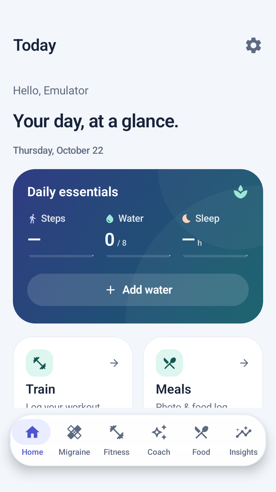</td><td>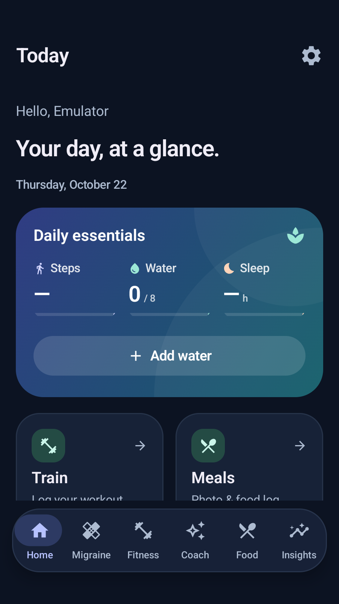</td></tr></table>

### Migraine

<table><tr><td>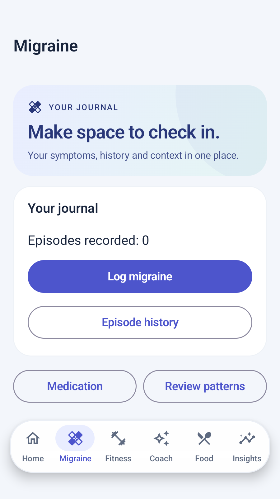</td><td>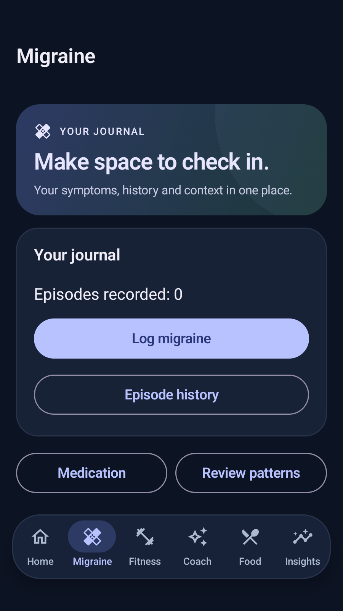</td></tr></table>

### Fitness

<table><tr><td>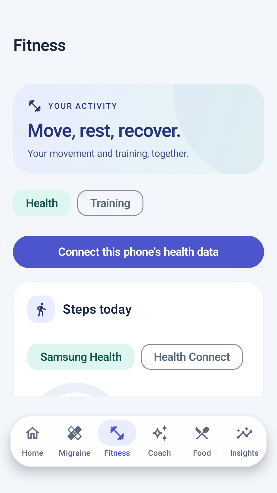</td><td>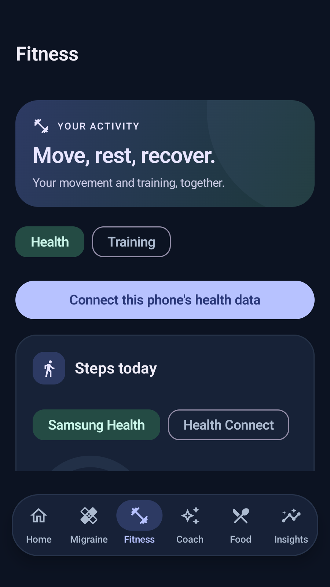</td></tr></table>

### Coach

<table><tr><td>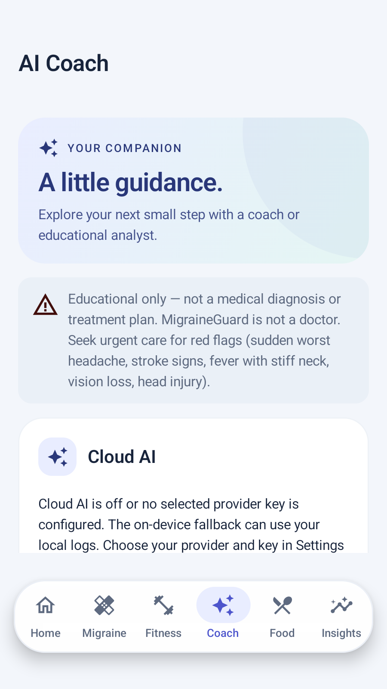</td><td>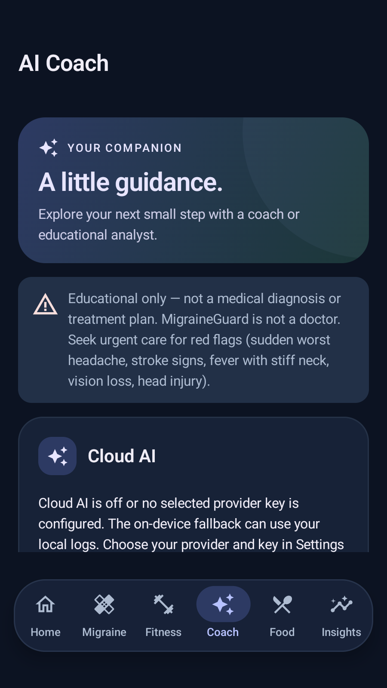</td></tr></table>

### Food

<table><tr><td>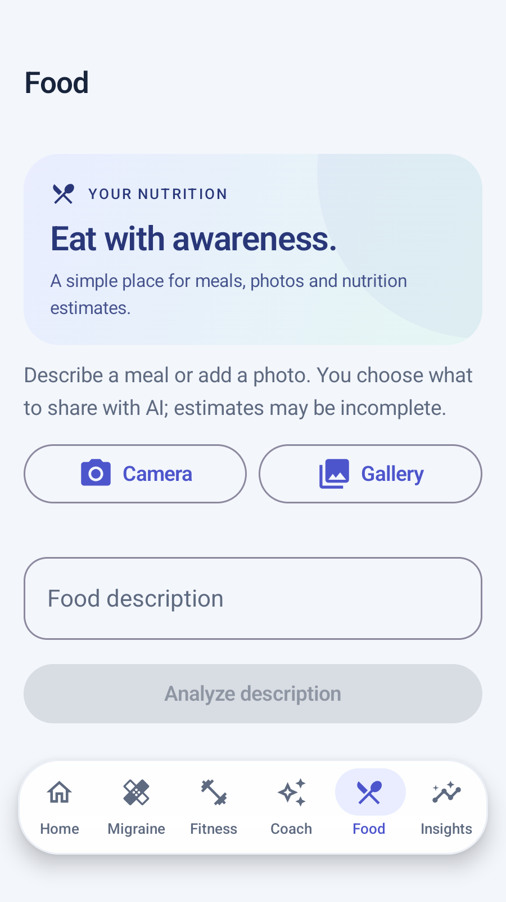</td><td>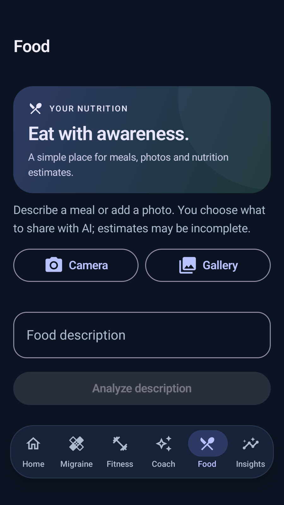</td></tr></table>

### Insights

<table><tr><td>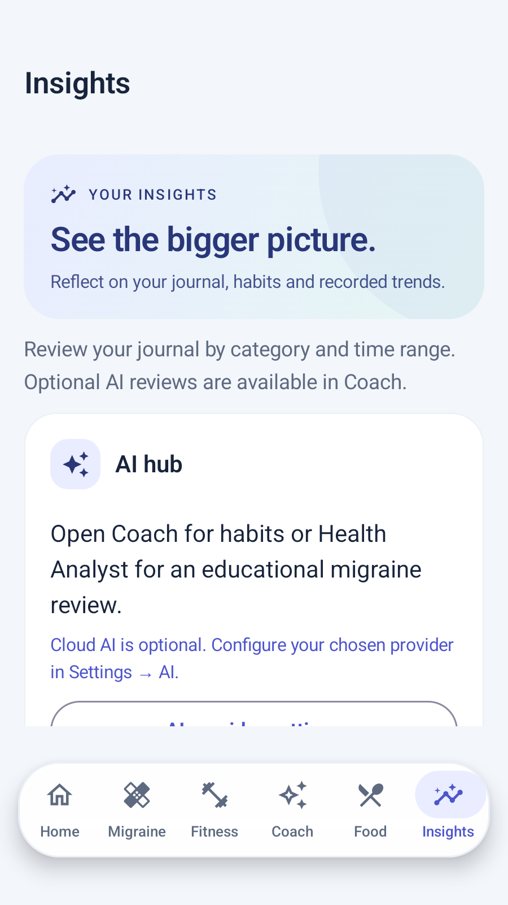</td><td>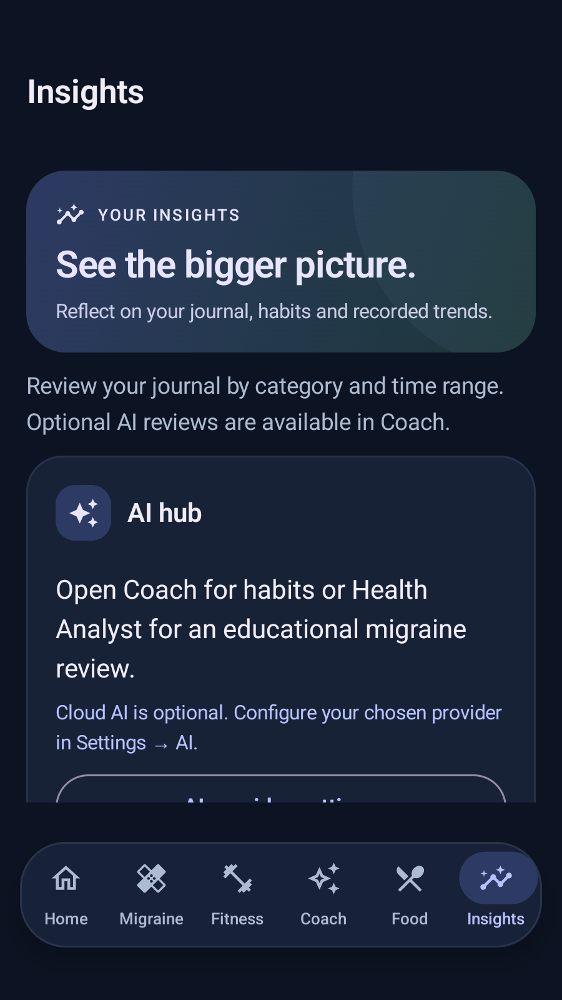</td></tr></table>

### Settings and exercise selection

<table><tr><td>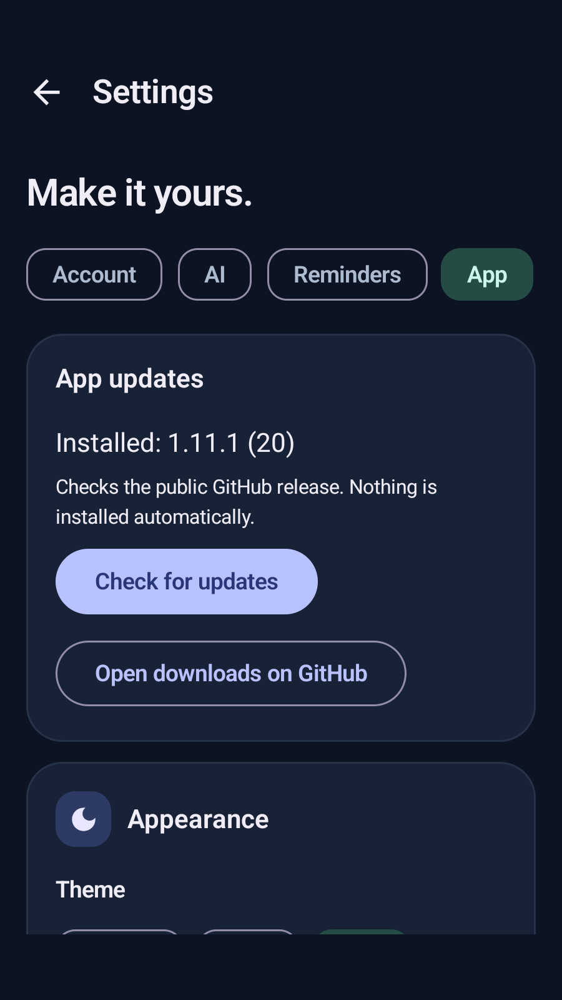</td><td>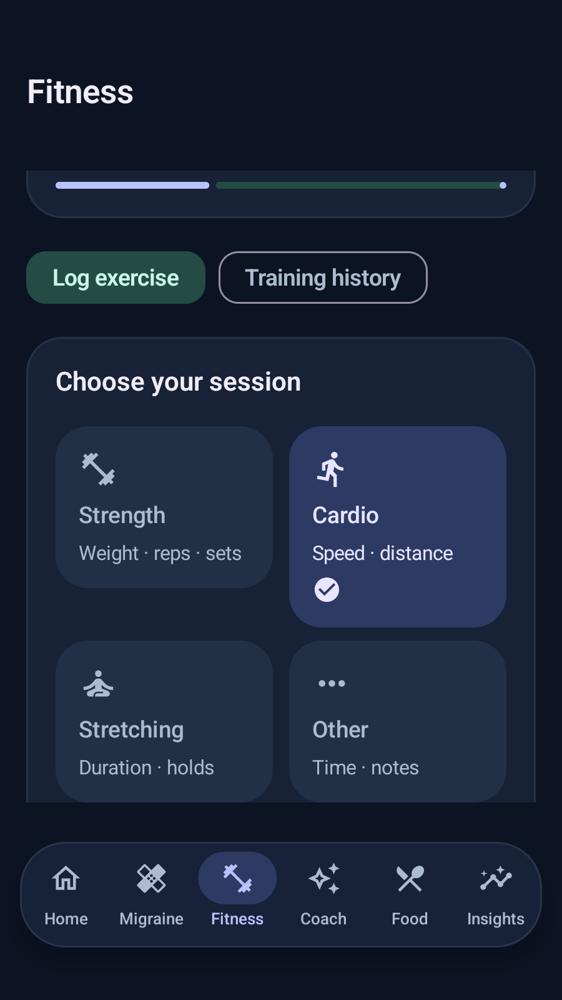</td></tr></table>
