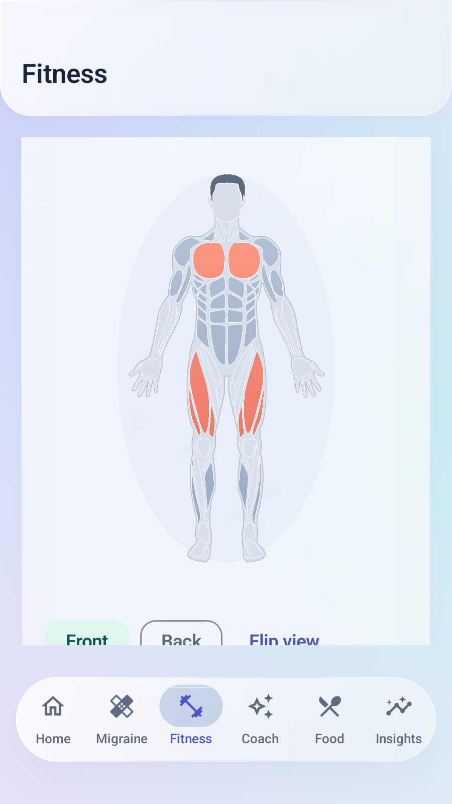
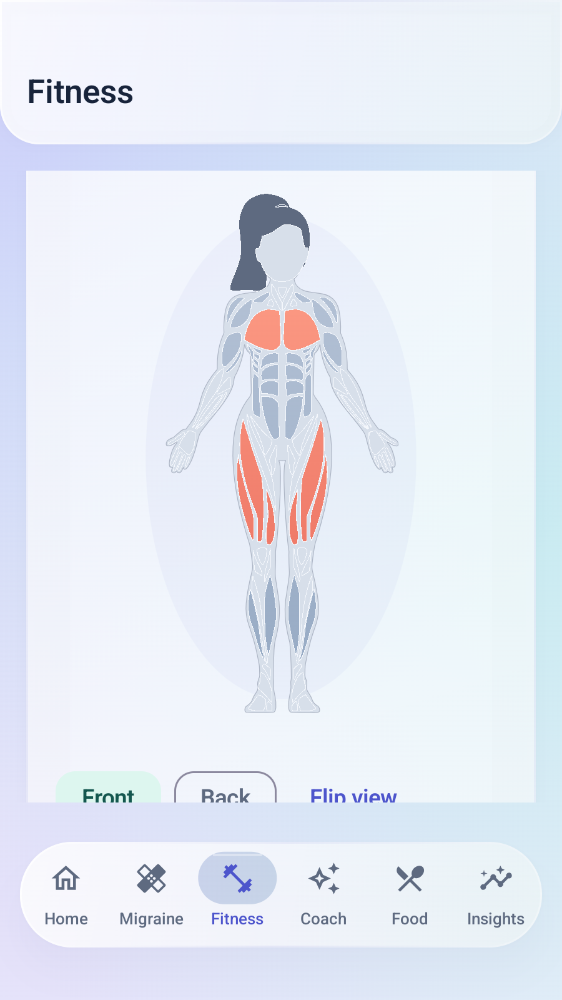

# v1.14.0 — anatomical muscle selector

This replaces the v1.13 polygon mannequin with flat anatomical illustrations. The visual reference was [MuscleWiki](https://musclewiki.com/); the bundled artwork is adapted from the MIT-licensed [react-native-body-highlighter](https://github.com/HichamELBSI/react-native-body-highlighter), pinned to commit 8ed39ac2ae9cb46fb79d77eedec7e5b029a75174. No MuscleWiki page asset, logo, exercise video, account or API is used.

## Using the selector

Open Fitness → Trainer. Pick Male or Female under Illustration. This changes the drawing only; it does not infer, overwrite or share the user's gender or body profile. Tap a supported muscle region to select it, tap again to remove it, and combine multiple targets. Coral highlights indicate selection. Front and Back, Flip view, or a horizontal swipe switch sides with a short slide/crossfade. This is a two-sided illustration, not continuous 3D rotation.

Selection survives switching sides and illustrations. Swipe gestures inside the map belong to the map; gestures outside retain main-tab navigation. Labeled muscle chips and accessibility Show front/Show back actions remain available. Android animation preferences affect the nominal 260-ms transition.

The twelve training targets remain Chest, Shoulders, Biceps, Triceps, Core, Obliques, Upper back, Lats, Glutes, Thighs/quads, Hamstrings and Calves. Head, hair, neck, hands, feet, joints, forearms, inner thighs and front shins are illustration details; they are not silently mapped to a different supported exercise target. These are approximate training regions, not a diagnostic pain map.

All existing session generation, equipment/experience/time preferences, calibrated/logged load advice, sets/reps/holds, rest timer, editable actual logging and optional AI weekly arrangement remain as described in the [training guide](UPDATE_1_13_0.md). No AI prompt, account namespace, backup format, database schema or health permission changes in this release.

## Native drawing and precise hit testing

Four JSON resources contain vector paths, body outlines and original SVG view boxes, extracted as data from the pinned licensed source. No React, JavaScript, remote renderer or additional Android dependency runs in the app.

AnatomyTransform.fit computes one uniform scale and centered offsets. Canvas drawing and inverse tap-coordinate conversion use that same transform, including the different source origins of the front/back and male/female views. Each resource is validated, parsed into Compose Paths and cached for the chosen illustration. Android Regions use those actual closed paths for hit testing, so gaps and unsupported body details do not become rectangular invisible buttons. Hits are ignored while the view is between sides to avoid selecting a muscle from an image that is still moving.

The broad lateral-back surfaces named upper-back in the upstream asset map to Lats; trapezius maps to Upper back. The lower-back surface maps to the existing Core training target. Deltoids map to Shoulders, abs to Core, gluteal to Glutes, quadriceps to Thighs/quads and hamstring to Hamstrings. Catalog coverage and exclusions are still checked by the existing trainer engine.

The drawing uses muted blue-gray muscle fills, fine separating contours and coral selection gradients in both app themes. Path parsing and Region construction happen once for each cached front/back pair, rather than sorting thousands of 3D faces every frame. This is an implementation improvement, not a measured frame-rate claim.

## Files and functions

| File | Role |
| --- | --- |
| app/src/main/java/com/migraineguard/app/feature/fitness/AnatomyMap.kt | AnatomyIllustration display choice; AnatomyAsset/AnatomyPart data validation; AnatomyTransform.fit and forward/inverse coordinates; AnatomyRegionMapping.muscleFor |
| app/src/main/java/com/migraineguard/app/feature/fitness/MuscleBodySelector.kt | prepareAnatomy caches Paths and exact Regions; PreparedAnatomy.hit selects a supported visible surface; native drawing, side transitions, selection and accessible controls |
| app/src/main/res/raw/anatomy_male_front.json and anatomy_male_back.json | Licensed male front/back vector data and outlines |
| app/src/main/res/raw/anatomy_female_front.json and anatomy_female_back.json | Licensed female front/back vector data and outlines |
| app/src/main/assets/licenses/body-highlighter-MIT.txt | Full upstream copyright, MIT license, source URL and pinned revision distributed inside the APK |
| THIRD_PARTY_NOTICES.md | Public source attribution and full license |
| app/src/test/java/com/migraineguard/app/feature/fitness/TrainerEngineTest.kt | Replaces obsolete mesh tests with all-target mapping and four-view coordinate round trips |
| app/src/androidTest/java/com/migraineguard/app/TrainerFlowTest.kt | Real male chest and female chest/glute taps, deselection, variant/side retention, map-owned swipes, captures, and existing trainer/logger/backup/AI checks |
| app/build.gradle.kts and .github/workflows/android.yml | Version 1.14.0/code24 and updated release description; existing retained-signature/runtime publication gates |

MuscleBodyMesh.kt is removed. References to it in the v1.13 guide describe that historical release, not the current selector.

## Troubleshooting

- A tap does nothing: wait for the side transition to finish, tap the filled region away from a narrow outline, or use its labeled chip. Some illustrated details have no exercise target.
- A chest selection seems to disappear on Back: it remains selected; chest is visible on Front and its chip remains selected.
- Swiping changes the wrong screen: begin inside the figure to switch sides, or outside it to move main tabs. The figure no longer simulates a 90-degree side angle.
- The illustration differs from the account profile: Male/Female is a display choice, separate from saved profile details. It is not a body scan or personal physique prediction.
- Transitions snap: check Android's animation/accessibility settings. The app respects disabled system animations.
- An old model remains: check Settings → App → About for 1.14.0/code24 and the intended Standard/Preview installation.

## Published v1.14.0 verification

[Release](https://github.com/jdp323/migraineguard/releases/tag/v1.14.0-debug) · [Run 40245349190](https://github.com/jdp323/migraineguard/actions/runs/40245349190) · [Exact APK source b63b8deb651e30173bab1bb906c9f7bf574c2e8d](https://github.com/jdp323/migraineguard/tree/b63b8deb651e30173bab1bb906c9f7bf574c2e8d). Both packages are 1.14.0/code24. Later documentation-only commits do not change the tested app source.

- 88 JVM tests passed, zero failures/errors. Compilation, Standard assembly, Android-test assembly and lint passed locally and on GitHub; Preview assembly passed on GitHub. Lint has zero errors and 118 warnings.
- All 37 API-35 Android runtime tests passed in 157.385 seconds. The trainer flow directly taps male chest and female chest/glute paths, checks deselection/reselection, keeps quads across side/illustration changes, asserts map-owned swipes, then builds/logs a real editable set/RIR and saves a week. Existing recovery/account-isolation, timed hold/draft protection and explicit AI consent/cancellation checks also passed.
- All six SwipeNavigationTest/TrainerFlowTest repeats passed with window, transition and animator scales at 1.0, in 61.591 seconds.
- Both APKs independently verify with the retained SHA-1 FB:67:0D:1D:96:C2:8B:9E:27:0D:36:F8:D6:57:53:E3:6B:30:8D:E8. The full artwork license is present inside both signed APKs.
- Public Standard, Preview, checksum and certificate assets were downloaded without account credentials. Both APKs match the tested artifacts and the release checksum file.

| APK | SHA-256 |
| --- | --- |
| MigraineGuard-v1.14.0-debug.apk | 945e5bc17596eff2efd3c1073dddc872efae4b16c346b46aadac2028914beb60 |
| MigraineGuard-v1.14.0-preview.apk | ff756e35b5bba1725e095aa59a38a64a8f186d0ed313f5c555d5c4513fc8b183 |

### Actual Android captures

These six running-app captures were visually inspected. They use synthetic test profiles and exercise records. Some views intentionally scroll to show the figure; the illustration-choice row is above the viewport. Android status/navigation bars are not included. The earlier browser artwork sheet is a separate design preview, not runtime evidence.

| Screen | Capture |
| --- | --- |
| Male Front, chest and quads selected | [Open](screenshots/v1.14.0/trainer-body-front-light.png) |
| Male Back, selections retained | [Open](screenshots/v1.14.0/trainer-body-back-light.png) |
| Female Front, chest and quads selected | [Open](screenshots/v1.14.0/anatomy-female-front-light.png) |
| Female Back, glutes added | [Open](screenshots/v1.14.0/anatomy-female-back-light.png) |
| Dark anatomical selector | [Open](screenshots/v1.14.0/trainer-body-dark.png) |
| Installed 1.14.0/code24 | [Open](screenshots/v1.14.0/settings-updates.png) |

<table><tr><td></td><td></td></tr></table>

Real-phone frame rate, TalkBack/larger-font acceptance, live provider quality and native wearable/Drive transport are not established by these synthetic emulator checks. Follow the [phone acceptance steps](PHONE_TESTING.md#v1140-acceptance).
