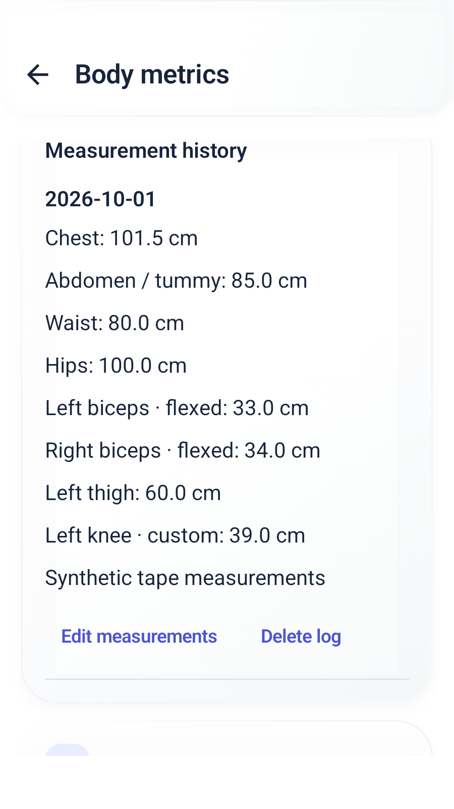
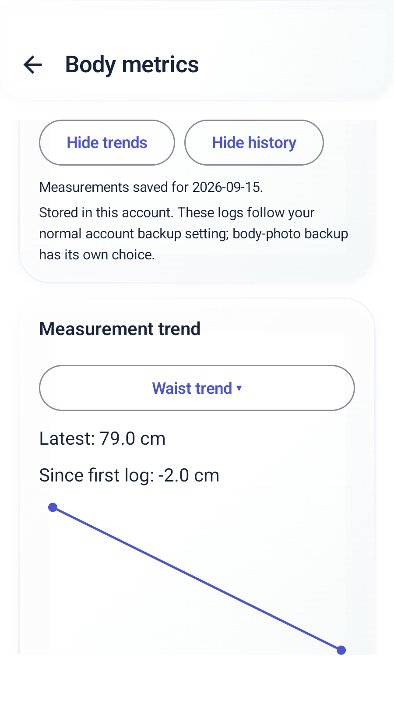
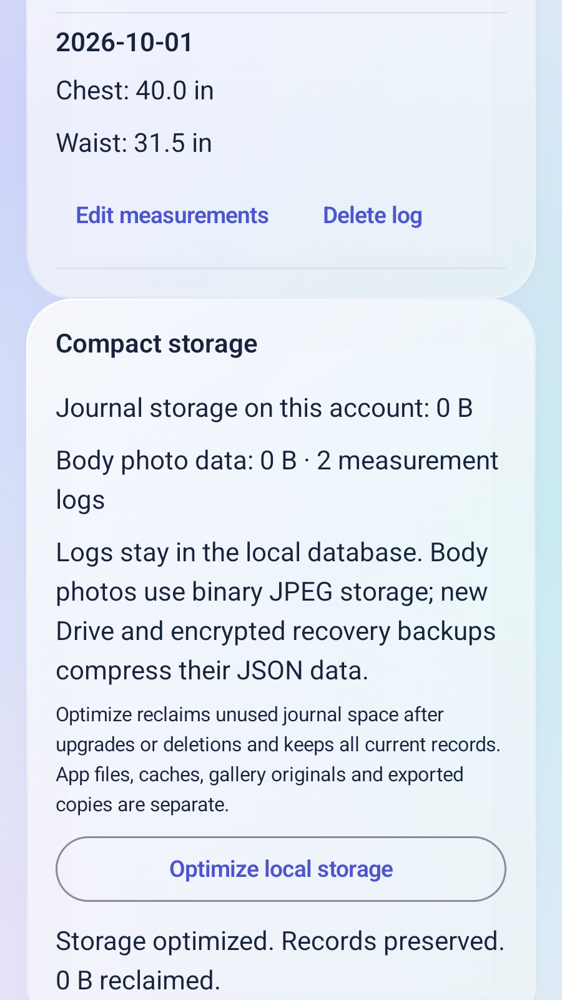

# v1.16.0 — dated measurements and compact storage

## Using body measurements

Open Settings → Account → Body measurements / photos / weight. Tap Log measurements, choose a date and fill any areas in Core, Upper body, Lower body or Custom. Units follow your profile (cm/in); an open draft retains its original unit even if profile settings change. Unused areas are omitted. Hiding/reopening the editor preserves the draft; Discard requires confirmation. No adult training preference is required.

There are 20 built-in circumference areas: neck, shoulders, chest, abdomen/tummy, waist, hips, left/right relaxed upper arms, flexed biceps, forearms, wrists, thighs, calves and ankles. Add up to eight custom areas per dated log. Weight and scale-reported body fat remain in their existing sections. These are tape measurements you enter, not image-derived estimates.

History supports multiple logs per date, editing dates/values and deletion. Trends select one area and use actual calendar spacing. The displayed change compares its first and latest recorded values, without assigning a health judgment. Old weight and photo/check-in measurements remain in their original histories.

## How storage changes

Local journals remain in account-separated Room/SQLite databases for atomic writes and reliable queries. New circumference rows store a compact JSON map of only filled areas, canonical centimetres, a date, notes and a revision. No whole-file JSON rewrite is needed for each log.

Room 7 → 8 copies each body-progress row into binary JPEG storage, preserving the exact JPEG bytes, IDs, dates, notes, measurements, revisions and deletion markers. This removes Base64's roughly one-third encoding overhead (binary payload is about 25% smaller than its Base64 representation). Actual total database savings depend on page allocation and other records. SQLite reuses freed pages; Settings → Data → Optimize local storage can reclaim unused pages with checkpoint/VACUUM. It does not remove current records. The displayed size includes this account's journal database and write-ahead log, not the APK, caches, external gallery originals, DataStore preferences or exported copies.

New Drive snapshots and password-encrypted recovery exports use compact JSON with omitted defaults and gzip when smaller. The password-encrypted outer MGBACK01/AES-GCM/PBKDF2 format is retained; compression runs before encryption. Readers auto-detect legacy uncompressed JSON after decryption or Drive download. Compressed and expanded data are each bounded at 20 MiB to prevent oversized restore/expansion. Compression is not encryption: Drive keeps its existing Google transport/storage protection, with portable provider keys in the account snapshot, not separate password encryption.

Readable ZIP exports already use compression; their JSON is now minified and ZIP compression uses the strongest standard level. body-measurements.csv contains dated canonical-cm values and deletion markers. Recovery/Drive include measurement records even when body-photo backup is off. Photo check-ins retain their independent Drive opt-in.

Update Standard in place rather than uninstalling to retain local records. The new table starts empty; earlier photo/weight measurements stay in their original histories instead of generating duplicates.

Manual journal format is 4 (reads 1–4); Drive envelope is 5 (reads 2–5). The historical hidden Drive filename migraineguard-account-v2.json is retained so existing accounts find the same file; its media body can now be gzip and upload MIME identifies it. Older apps cannot read the new compressed snapshot, so update all devices before using new backups. New readers restore old files. No login token or raw Health Connect record is added to exports; readable/manual exports still exclude provider keys.

## Record safety and privacy

Circumference records belong to the signed-in account's database. Save/edited revisions increase monotonically; deleted records retain an ID/date/revision marker with measurements/notes cleared. Merging older snapshots cannot resurrect them. They follow the existing enabled private Drive account backup. They are not newly added to any AI prompt or sent to a developer server. No new Health Connect/Google permission, cloud scope or billing service is needed.

## File and function map

| File (Kotlin paths relative to app/src/main/java/com/migraineguard/app) | Responsibility |
| --- | --- |
| feature/body/BodyMeasurementModels.kt | Area catalog, unit conversion/rounding, custom IDs, labels and chronological trend points |
| core/data/db/BodyMeasurementDao.kt | Dated map/revision/tombstone validation, observable history, get/put |
| feature/body/BodyMeasurementRepository.kt | Account-local saves/edits, future-date guard and monotonic deletions |
| feature/body/BodyMeasurementsPanel.kt | Grouped optional editor, saved drafts/units, custom areas, edit/delete/history and calendar-spaced chart |
| feature/body/BodyMetricsScreen.kt; navigation/MigraineGuardNavHost.kt; di/AppContainer.kt | Body-screen and account graph integration |
| core/data/db/BodyProgressDao.kt | Portable photo DTO remains compatible; storage rows use JPEG BLOBs |
| core/data/db/Converters.kt; AppDatabase.kt; PreservingMigrations.kt | Compact map codec, schema 8 and transactional 7→8 photo/measurement migration |
| core/storage/CompactJson.kt | Bounded gzip-if-smaller pack, legacy/plain detection and expansion-limited restore |
| feature/backup/BackupRepository.kt | Measurement snapshots/merge, compact recovery payload before existing encryption |
| feature/settings/CloudBackupFormat.kt | Format 5 compact envelope, old/new decoding, stable data fingerprint |
| feature/settings/DriveRestClient.kt; DriveSyncRepository.kt | Binary-safe gzip upload, actual stored-byte metadata and measurement-change sync |
| feature/backup/DataExport.kt | Compressed/minified JSON and canonical body-measurements CSV |
| feature/backup/JournalStorage.kt; JournalStorageCard.kt; feature/settings/SettingsScreen.kt | Account journal/photo size and safe explicit space reclamation |
| app/src/test/.../CompactJsonTest.kt; BodyMeasurementTest.kt; CloudBackupTest.kt | Compression, corruption/bounds, old files, units, dates, validation and binary HTTP payloads |
| app/src/androidTest/.../BodyMeasurementsTest.kt | v7 photo/journal migration and compaction; encrypted/legacy/Drive-format measurement merge; metric and imperial UI/draft/history/trend/delete flows |
| app/src/androidTest/.../DriveRestoreTest.kt; AppReliabilityTest.kt; BodyProgressTest.kt | Normal Drive measurement restore and earlier schema/photo/export regressions |
| .github/workflows/android.yml | 48 main Android tests, 17 larger-text repeats, existing preflights/smoke/signer publication gates |

### Release crash-log maintenance

The first attempt of the tested e9fa3942 source required a retry because the emulator's Google Wallpaper process crashed during the initial preflight; all 48 main and 17 larger-text app tests passed. The complete log identifies com.google.android.apps.wallpaper, with no MigraineGuard fatal exception. Future CI uses [scripts/check_android_crashes.py](../scripts/check_android_crashes.py) (`classify`, `main`), tested by [scripts/test_android_crashes.py](../scripts/test_android_crashes.py), rather than rejecting every Android service crash. It still fails for this app, its background/test processes or an unidentified fatal block, and retains unrelated process evidence. Eight standalone Python fixtures and the actual captured wallpaper log verify classification locally. This CI-only change does not alter the APK; the version tag remains pinned to the tested app source.

### Main function contracts

- feature/body/BodyMeasurementModels.kt: `customId`, `knownKey`, `label`, `centimetres`, `displayed`, `parse`, `draft`, `orderedKeys`, `points`. See responsibilities above; generated Room/serialization methods are compiler-owned.
- feature/body/BodyMeasurementRepository.kt: `observe`, `save`, `remove`. See responsibilities above; generated Room/serialization methods are compiler-owned.
- core/data/db/BodyMeasurementDao.kt: `validate`, `observe`, `all`, `get`, `put`. See responsibilities above; generated Room/serialization methods are compiler-owned.
- core/data/db/BodyProgressDao.kt: `validate`, `portable`, `from`, `observeRows`, `allRows`, `getRow`, `putRow`, `observe`, `all`, `get`, `put`. See responsibilities above; generated Room/serialization methods are compiler-owned.
- core/storage/CompactJson.kt: `isCompressed`, `pack`, `unpack`. See responsibilities above; generated Room/serialization methods are compiler-owned.
- feature/backup/JournalStorage.kt: `usage`, `readUsage`, `optimize`. See responsibilities above; generated Room/serialization methods are compiler-owned.

### Reviewed source files

- [.github/workflows/android.yml](https://github.com/jdp323/migraineguard/blob/e9fa3942dd5324b38517abd9c48ab39008816e3a/.github/workflows/android.yml)
- [app/build.gradle.kts](https://github.com/jdp323/migraineguard/blob/e9fa3942dd5324b38517abd9c48ab39008816e3a/app/build.gradle.kts)
- [app/schemas/com.migraineguard.app.core.data.db.AppDatabase/8.json](https://github.com/jdp323/migraineguard/blob/e9fa3942dd5324b38517abd9c48ab39008816e3a/app/schemas/com.migraineguard.app.core.data.db.AppDatabase/8.json)
- [app/src/androidTest/java/com/migraineguard/app/AppReliabilityTest.kt](https://github.com/jdp323/migraineguard/blob/e9fa3942dd5324b38517abd9c48ab39008816e3a/app/src/androidTest/java/com/migraineguard/app/AppReliabilityTest.kt)
- [app/src/androidTest/java/com/migraineguard/app/BodyMeasurementsTest.kt](https://github.com/jdp323/migraineguard/blob/e9fa3942dd5324b38517abd9c48ab39008816e3a/app/src/androidTest/java/com/migraineguard/app/BodyMeasurementsTest.kt)
- [app/src/androidTest/java/com/migraineguard/app/BodyProgressTest.kt](https://github.com/jdp323/migraineguard/blob/e9fa3942dd5324b38517abd9c48ab39008816e3a/app/src/androidTest/java/com/migraineguard/app/BodyProgressTest.kt)
- [app/src/androidTest/java/com/migraineguard/app/DriveRestoreTest.kt](https://github.com/jdp323/migraineguard/blob/e9fa3942dd5324b38517abd9c48ab39008816e3a/app/src/androidTest/java/com/migraineguard/app/DriveRestoreTest.kt)
- [app/src/androidTest/java/com/migraineguard/app/FullAppSimulationTest.kt](https://github.com/jdp323/migraineguard/blob/e9fa3942dd5324b38517abd9c48ab39008816e3a/app/src/androidTest/java/com/migraineguard/app/FullAppSimulationTest.kt)
- [app/src/main/java/com/migraineguard/app/core/data/db/AppDatabase.kt](https://github.com/jdp323/migraineguard/blob/e9fa3942dd5324b38517abd9c48ab39008816e3a/app/src/main/java/com/migraineguard/app/core/data/db/AppDatabase.kt)
- [app/src/main/java/com/migraineguard/app/core/data/db/BodyMeasurementDao.kt](https://github.com/jdp323/migraineguard/blob/e9fa3942dd5324b38517abd9c48ab39008816e3a/app/src/main/java/com/migraineguard/app/core/data/db/BodyMeasurementDao.kt)
- [app/src/main/java/com/migraineguard/app/core/data/db/BodyProgressDao.kt](https://github.com/jdp323/migraineguard/blob/e9fa3942dd5324b38517abd9c48ab39008816e3a/app/src/main/java/com/migraineguard/app/core/data/db/BodyProgressDao.kt)
- [app/src/main/java/com/migraineguard/app/core/data/db/Converters.kt](https://github.com/jdp323/migraineguard/blob/e9fa3942dd5324b38517abd9c48ab39008816e3a/app/src/main/java/com/migraineguard/app/core/data/db/Converters.kt)
- [app/src/main/java/com/migraineguard/app/core/data/db/PreservingMigrations.kt](https://github.com/jdp323/migraineguard/blob/e9fa3942dd5324b38517abd9c48ab39008816e3a/app/src/main/java/com/migraineguard/app/core/data/db/PreservingMigrations.kt)
- [app/src/main/java/com/migraineguard/app/core/storage/CompactJson.kt](https://github.com/jdp323/migraineguard/blob/e9fa3942dd5324b38517abd9c48ab39008816e3a/app/src/main/java/com/migraineguard/app/core/storage/CompactJson.kt)
- [app/src/main/java/com/migraineguard/app/di/AppContainer.kt](https://github.com/jdp323/migraineguard/blob/e9fa3942dd5324b38517abd9c48ab39008816e3a/app/src/main/java/com/migraineguard/app/di/AppContainer.kt)
- [app/src/main/java/com/migraineguard/app/feature/backup/BackupRepository.kt](https://github.com/jdp323/migraineguard/blob/e9fa3942dd5324b38517abd9c48ab39008816e3a/app/src/main/java/com/migraineguard/app/feature/backup/BackupRepository.kt)
- [app/src/main/java/com/migraineguard/app/feature/backup/DataExport.kt](https://github.com/jdp323/migraineguard/blob/e9fa3942dd5324b38517abd9c48ab39008816e3a/app/src/main/java/com/migraineguard/app/feature/backup/DataExport.kt)
- [app/src/main/java/com/migraineguard/app/feature/backup/JournalStorage.kt](https://github.com/jdp323/migraineguard/blob/e9fa3942dd5324b38517abd9c48ab39008816e3a/app/src/main/java/com/migraineguard/app/feature/backup/JournalStorage.kt)
- [app/src/main/java/com/migraineguard/app/feature/backup/JournalStorageCard.kt](https://github.com/jdp323/migraineguard/blob/e9fa3942dd5324b38517abd9c48ab39008816e3a/app/src/main/java/com/migraineguard/app/feature/backup/JournalStorageCard.kt)
- [app/src/main/java/com/migraineguard/app/feature/body/BodyMeasurementModels.kt](https://github.com/jdp323/migraineguard/blob/e9fa3942dd5324b38517abd9c48ab39008816e3a/app/src/main/java/com/migraineguard/app/feature/body/BodyMeasurementModels.kt)
- [app/src/main/java/com/migraineguard/app/feature/body/BodyMeasurementRepository.kt](https://github.com/jdp323/migraineguard/blob/e9fa3942dd5324b38517abd9c48ab39008816e3a/app/src/main/java/com/migraineguard/app/feature/body/BodyMeasurementRepository.kt)
- [app/src/main/java/com/migraineguard/app/feature/body/BodyMeasurementsPanel.kt](https://github.com/jdp323/migraineguard/blob/e9fa3942dd5324b38517abd9c48ab39008816e3a/app/src/main/java/com/migraineguard/app/feature/body/BodyMeasurementsPanel.kt)
- [app/src/main/java/com/migraineguard/app/feature/body/BodyMetricsScreen.kt](https://github.com/jdp323/migraineguard/blob/e9fa3942dd5324b38517abd9c48ab39008816e3a/app/src/main/java/com/migraineguard/app/feature/body/BodyMetricsScreen.kt)
- [app/src/main/java/com/migraineguard/app/feature/settings/CloudBackupFormat.kt](https://github.com/jdp323/migraineguard/blob/e9fa3942dd5324b38517abd9c48ab39008816e3a/app/src/main/java/com/migraineguard/app/feature/settings/CloudBackupFormat.kt)
- [app/src/main/java/com/migraineguard/app/feature/settings/DriveRestClient.kt](https://github.com/jdp323/migraineguard/blob/e9fa3942dd5324b38517abd9c48ab39008816e3a/app/src/main/java/com/migraineguard/app/feature/settings/DriveRestClient.kt)
- [app/src/main/java/com/migraineguard/app/feature/settings/DriveSyncRepository.kt](https://github.com/jdp323/migraineguard/blob/e9fa3942dd5324b38517abd9c48ab39008816e3a/app/src/main/java/com/migraineguard/app/feature/settings/DriveSyncRepository.kt)
- [app/src/main/java/com/migraineguard/app/feature/settings/SettingsScreen.kt](https://github.com/jdp323/migraineguard/blob/e9fa3942dd5324b38517abd9c48ab39008816e3a/app/src/main/java/com/migraineguard/app/feature/settings/SettingsScreen.kt)
- [app/src/main/java/com/migraineguard/app/navigation/MigraineGuardNavHost.kt](https://github.com/jdp323/migraineguard/blob/e9fa3942dd5324b38517abd9c48ab39008816e3a/app/src/main/java/com/migraineguard/app/navigation/MigraineGuardNavHost.kt)
- [app/src/test/java/com/migraineguard/app/core/storage/CompactJsonTest.kt](https://github.com/jdp323/migraineguard/blob/e9fa3942dd5324b38517abd9c48ab39008816e3a/app/src/test/java/com/migraineguard/app/core/storage/CompactJsonTest.kt)
- [app/src/test/java/com/migraineguard/app/feature/body/BodyMeasurementTest.kt](https://github.com/jdp323/migraineguard/blob/e9fa3942dd5324b38517abd9c48ab39008816e3a/app/src/test/java/com/migraineguard/app/feature/body/BodyMeasurementTest.kt)
- [app/src/test/java/com/migraineguard/app/feature/settings/CloudBackupTest.kt](https://github.com/jdp323/migraineguard/blob/e9fa3942dd5324b38517abd9c48ab39008816e3a/app/src/test/java/com/migraineguard/app/feature/settings/CloudBackupTest.kt)

## Screenshots

Native captures use synthetic records. The imperial storage-control fixture is in-memory, so its 0 B size is not a real-phone estimate; the on-disk migration benchmark below measures actual bytes. Screens were also inspected at font scale 1.25 with animations enabled.

<table><tr><td></td><td></td><td></td></tr></table>

## Verification

[Run 41163227312, attempt 2](https://github.com/jdp323/migraineguard/actions/runs/41163227312/attempts/2), source e9fa3942dd5324b38517abd9c48ab39008816e3a: **100 JVM tests, 48 Android runtime tests, two focused larger-text preflights and 17 animation-enabled repeats at font scale 1.25 passed**. Main runtime 204.682 s, preflights 77.028 s, repeats 195.107 s. Lint: zero errors, 122 warnings. Standard/Preview compilation and retained signing passed.

The seeded smoke run reported 300 events with an empty Android fatal-exception log. Two hardware keyboard/flip injections were blocked by emulator /dev/input/event0 permissions and are not counted as proven actions. The previous attempt passed all app tests but failed the old global crash check because the emulator's Google Wallpaper process crashed. The successful retry retained the same APK bytes.

Both anonymous public APK downloads match the tested artifact hashes, report 1.16.0/code26 and retain SHA-1 FB:67:0D:1D:96:C2:8B:9E:27:0D:36:F8:D6:57:53:E3:6B:30:8D:E8. Nine GIFs and both complete license files match source inside each APK; migration-test schema assets are excluded from phone APKs.

| Package | SHA-256 |
| --- | --- |
| [Standard](https://github.com/jdp323/migraineguard/releases/download/v1.16.0-debug/MigraineGuard-v1.16.0-debug.apk) | 4013e101fc2c182ea8e8fbc36b1a2a78c9f82d595ef74803d3517e7e8d30aef9 |
| [Preview](https://github.com/jdp323/migraineguard/releases/download/v1.16.0-debug/MigraineGuard-v1.16.0-preview.apk) | 16fd3bce078b0720bdb9265419d4081ea4035809a29b7b6f88489550db892bef |

The real populated v7 migration fixture preserved exact JPEG bytes, notes, measurements, deletion markers and older journals; compaction preserved records. Compressed/legacy encrypted restore, old Base64 photo import, measurement revisions/tombstones and simulated Drive restore passed. Metric/imperial forms, multiple groups/custom areas, date edits, history/trends, draft protection and delete/optimization were exercised on rendered Android components. Six normal/larger-text captures were visually inspected.

| Synthetic storage comparison | Before | After |
| --- | ---: | ---: |
| Photo payload: Base64 text → exact JPEG bytes | 1112 B | 833 B |
| Compact journal JSON → packed snapshot | 1830 B | 887 B |
| Journal database + WAL before/after Optimize | 86096 B | 77824 B |

These are measured disposable-fixture sizes, not a promised percentage reduction for every user's database. Already-compressed JPEGs, record mix and SQLite page allocation affect results.

Real Google authorization/transfer, actual wearable/Health Connect synchronization, live provider responses and OEM notification delivery remain phone acceptance checks; deterministic emulator fixtures do not prove them. [Functional matrix and limits](SIMULATION_REPORT.md) · [Phone checklist](PHONE_TESTING.md).
